# Nordic 44 grid analysis

Load flow, N-1 security, optimal power flow and redispatch for every hour of 2015 on
**Nordic 44**, a 44-bus equivalent of the Nordic synchronous grid (Sweden, Norway, Finland),
using hourly snapshots matched to Nord Pool market data. The analysis runs in Python on
[pandapower](https://www.pandapower.org/) and a purpose-written AC solver. It is checked
against the PSS/E solutions shipped with the dataset and against DIgSILENT PowerFactory, which
built its own model of the same data, so three tools solve the same network. The PowerFactory
projects are included, ready to open.

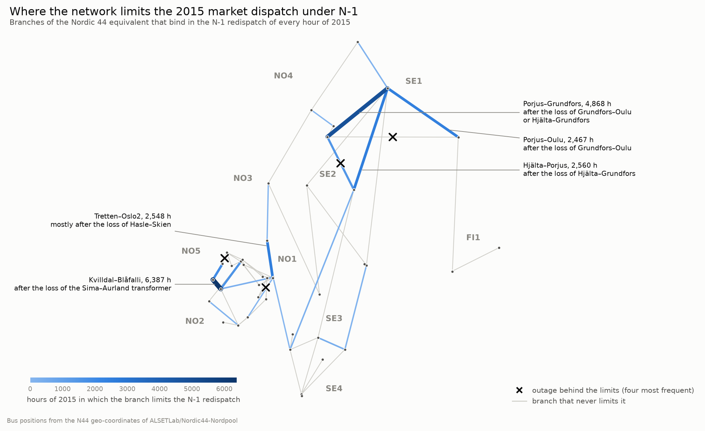

## Main results

- **pandapower, PowerFactory 2024 and PSS/E give the same answer.** pandapower and
  PowerFactory agree to 5·10⁻⁸ p.u. and 3·10⁻⁴ MW once one importer convention is undone.
  PowerFactory rounds transformer ratios to tap positions, and that alone puts 2.6 Mvar on
  some branches. The agreement also holds for N-1 (355 outages, flows to 8·10⁻⁴ MW) and for
  the DC-OPF (cost to the cent, identical nodal prices).
- **The market dispatch of the equivalent is N-1 secure in only 324 hours of 2015.** A full
  AC N-1 of every hour (8,760 h × 71 outages = 622,000 cases, about 0.5 ms each with the
  project's own solver) finds 11.8 % of cases insecure. The outages that dominate are the
  aggregated Sima transformer in NO5, the SE1/SE2 north–south lines and the NO1–NO2–NO5
  interface.
- **Snitt 2 (SE2→SE3) is the limit, and the limit sits north of it.** Its N-1 transfer
  capability is 3.2 GW in the median hour, and the market flow is above it in 5,991 hours.
  The elements that set it are the Porjus–Grundfors–Hjälta lines in SE1/SE2, not the
  Hjälta–Ringhals circuits where the intact network binds.
- **Making the market dispatch N-1 secure takes 19.2 TWh of redispatch** (5.6 % of demand),
  almost all of it countertrade from the north into SE3. Of that, 8.1 TWh comes from one
  outage that is an artefact of the equivalent, and the Swedish part barely changes without
  it. A sample of 110 hours checked in AC needs 13 % more.
- **Reinforcement helps at the N-1 bottleneck, north of snitt 2.** A third Hjälta–Ringhals
  circuit, where the intact network binds, leaves the N-1 redispatch unchanged (+0.3 %). A
  second Hjälta–Grundfors circuit at the N-1 bottleneck cuts it by 23 % and lifts snitt 2's
  median N-1 capability from 3.2 to 5.0 GW. New industrial load in SE1/SE2 relieves the
  corridors up to about 3 GW, and without reinforcement the 2015 network takes 6 to 8 GW of
  it.
- **A DC screening catches overloads but cannot judge voltage.** Estimated from each hour's
  AC flows plus LODF, post-contingency loading is within 0.66 points of AC in 95 % of cases.
  At a 90 % threshold the screening misses 40 of 62,548 overloads and spares 65 % of the AC
  runs. Low voltages still need AC.
- **The equivalent departs from the market data on some borders.** Net positions match Nord
  Pool by construction, yet the NO1–NO2–NO5 triangle carries a 1.4 GW loop flow that Nord
  Pool does not show, and two artificial ties re-route Finland's import. Snitt 2, measured as
  a cut, is within 5 % of Nord Pool.
- **Against ENTSO-E's data, the equivalent's limits hold on two cuts out of three.** On snitt 1
  and snitt 4 the capacity the TSOs gave the market in 2015 is within 13 % of the equivalent's
  N-1 capability, but on snitt 2 it is twice as large (6.5 against 3.2 GW), so the equivalent
  overstates snitt 2's congestion. The DC-OPF finds Finland's price step (29.2 against a real
  29.7 EUR/MWh) and none of the smaller separations inside Scandinavia. The dataset's border
  exchanges turn out to be measured physical flows.
- **On the 2015 grid, the flows of 2025 leave little that is secure.** Snapshots of 2025 built
  from ENTSO-E data with the dataset's own method, which reproduces the 2015 snapshots, raise
  snitt 2's mean flow from 3.6 to 5.6 GW. The market dispatch is then N-1 secure in 121 hours
  instead of 324, and in 17 winter hours the intact grid has no AC solution at all.

## Contents

- [Background](#background)
- [Model and data](#model-and-data)
- [Methods](#methods)
- [Validation (P6)](#validation-p6)
- [Results](#results)
  - [P1. Inter-zonal flows against Nord Pool](#p1-how-well-does-n44-reproduce-nord-pools-inter-zonal-flows)
  - [P2. Corridors that limit the north–south transfer](#p2-which-corridors-limit-the-northsouth-transfer)
  - [P3. Critical contingencies and N-1 margins](#p3-which-contingencies-are-critical-and-how-much-n-1-margin-is-there)
  - [P4. Nodal prices and redispatch](#p4-nodal-prices-and-the-redispatch-the-market-dispatch-needs)
  - [P5. Reinforcements and new northern demand](#p5-reinforcements-and-new-northern-demand)
  - [P7. The 2015 grid with the flows of 2025](#p7-the-2015-grid-with-the-flows-of-2025)
- [Conclusions](#conclusions)
- [Limitations and next steps](#limitations-and-next-steps)
- [Reproducing the results](#reproducing-the-results)
- [PowerFactory projects](#powerfactory-projects)
- [Repository layout](#repository-layout)
- [Data, licences and references](#data-licences-and-references)

## Background

The Nordic synchronous system links Sweden, Norway, Finland and eastern Denmark. Most of its
hydro power sits in the north and most of its demand in the south, and the transmission
corridors between them decide how much of the northern surplus reaches the south. Svenska
kraftnät supervises these corridors as transfer sections (*snitt*). The market splits Sweden
into four bidding zones along them, and their limits shape prices, redispatch and investment.

This project studies that system on Nordic 44 (N44) with an open dataset of hourly snapshots
of 2015 matched to Nord Pool's market data. It answers seven questions.

- **P1.** How accurately does a 44-bus equivalent reproduce the inter-zonal flows recorded by
  Nord Pool, and where and why does it fail?
- **P2.** Which corridors limit the north–south transfer, for how many hours a year and under
  which conditions?
- **P3.** Which contingencies are critical, when do they occur, and how much N-1 margin does
  the system have in the hours of highest transfer?
- **P4.** How large are nodal price differences under transparent cost assumptions, and how
  much redispatch would make the market dispatch N-1 secure?
- **P5.** How do the answers to P2–P4 change with a reinforcement of the most limiting
  corridor, in AC or HVDC, and with new industrial load and wind in the north?
- **P6.** Which differences appear between pandapower, PowerFactory and PSS/E for the same
  network, and which modelling decisions explain them?
- **P7.** How would the 2015 grid cope with the flows of a recent year, built from public data
  with the dataset's own method?

P6 is answered in [Validation](#validation-p6) and the others in [Results](#results).

## Model and data

Nordic 44 is an equivalent of the Nordic synchronous system developed at KTH's SmarTS Lab. It
has 44 buses, at 420 kV and 300 kV except one at 135 kV, with 67 lines, 12 two-winding
transformers and 80 machines grouped at 18 generator buses. Of its 48 loads, 13 stand for
exchanges with neighbours outside the model (the HVDC links to Denmark, Germany, Poland, the
Baltic states and Russia) or for links carried by load pairs inside it (Fenno-Skan and the
NO4–FI border). Each PSS/E area is one of the Nord Pool bidding zones NO1–NO5, SE1–SE4 and FI.
The system base is 1000 MVA, and the bus at Oskarshamn (3300, SE3) is the swing bus.


*The Nordic 44 equivalent by bidding zone, at the buses' geographic positions. Dark lines are
ties between zones. The two dashed ties have no Nord Pool border, and the dotted links are
carried by pairs of exchange loads.*

Being an equivalent, N44 is coarse in two ways that recur in the results. Branch ratings belong
to the equivalent and are not the real limits of the corridors it represents. Each generator
bus also aggregates many real plants, so a single bus may hold several gigawatts. Two ties of
the equivalent, Forsmark–Porjus (SE3–SE1) and Grundfors–Oulu (SE2–FI), have no counterpart
among Nord Pool's borders.

The dataset holds a PSS/E case for every hour of 2015, before and after PSS/E's power flow.
The toolbox that built it scaled each area's loads and generation to Nord Pool's hourly
consumption and production, set the exchange loads to Nord Pool's exchanges and solved each
hour with tap stepping, area-interchange control and reactive limits. The dataset also ships
Nord Pool's daily files and PSS/E's per-hour summary. Three quirks of the data matter here.

- The published base case is not a solved power flow, because its generation was rescaled
  after the last solution.
- Hour 2015-03-29 02:00 does not exist. Its snapshot holds Nord Pool's interpolation and is
  left out of comparisons with market data.
- On the clock-change day 2015-10-25 the files have 25 rows, and the toolbox kept the first 24.

The dataset, its construction and the Nord Pool files are described in
[data/README.md](data/README.md).

The ENTSO-E Transparency Platform supplies what the dataset lacks. For 2015 it gives the
day-ahead prices, the capacity the TSOs offered to the day-ahead market on each border, and
the physical flows and scheduled exchanges. For 2025 it gives each zone's load and generation
and the physical flows on every border and link. Downloading them needs a free token (see
[Reproducing the results](#reproducing-the-results)).

## Methods

Every step is a numbered script in `scripts/`, and the library code is in `src/n44/`. The
details and the equations are in [docs/methods.md](docs/methods.md).

- **Parser and reference model.** A parser written for this project reads the PSS/E
  revision-33 RAW format. A reference admittance matrix is built straight from the PSS/E
  branch equations, independently of any power-flow tool.
- **pandapower model.** The network keeps the PSS/E bus numbers and the 1000 MVA base, and
  every conversion rule is exact for N44, so its admittance matrix equals the reference one.
- **Annual load flow.** Each of the 8,760 hours is solved in AC from a flat start. Branch flows
  are aggregated into borders between bidding zones and into the Swedish cuts, defined as
  flows between sets of zones. Snitt 1 runs from SE1 to SE2–SE4, snitt 2 from SE1–SE2 to
  SE3–SE4 and snitt 4 from SE1–SE3 to SE4.
- **N-1 security.** Every hour is checked against 71 outages, every line and transformer
  except the radial HVDC connections. A case is insecure if it has no AC solution, if a bus
  falls below 0.90 p.u., or if a branch exceeds RATE B while it was within RATE B before the
  outage. A DC screening with PTDF and LODF covers the year in about five seconds, and a
  Newton–Raphson solver written on the reference model runs the full AC N-1 at about 0.5 ms
  per case.
- **Transfer capability.** The N-1 transfer capability of each cut is measured from each
  hour's secure state, with the critical elements chosen as in flow-based capacity
  calculation.
- **DC-OPF and redispatch.** Both are linear programs in PTDF form, solved with HiGHS. The OPF
  gives nodal prices under assumed costs (nuclear 10, hydro 20, thermal 35 EUR/MWh). The
  redispatch finds the smallest volume that makes the market dispatch secure.
- **Scenarios.** Reinforcements, new northern load and new wind go through the same chain on
  every seventh hour of 2015.
- **Market data.** The ENTSO-E series are averaged to hours and put on the dataset's hour
  index, with the same handling of the two clock-change days.
- **Snapshots for another year.** The dataset's method is written again on the project's
  solver. Each zone's loads and generation are scaled to the market data, and each hour is
  solved with area-interchange control and tap stepping. On 2015's own data it reproduces the
  dataset's snapshots, and it builds the snapshots of 2025 on the 2015 grid.

| Step | Scripts | What they do |
|---|---|---|
| Data | `01_download_data.py`, `02_inventory.py`, `03_check_psse_consistency.py` | download the dataset, list its files and check every PSS/E solution |
| Model | `04_build_network.py`, `05_build_snapshots.py` | build the pandapower network and the hourly tables |
| Checks | `06_validate_psse.py`, `07_nordpool_dc_comparison.py` | pandapower against PSS/E, the borders against Nord Pool, AC against DC |
| Year | `08_powerflow_8760.py`, `09_annual_analysis.py` | AC load flow of every hour, cuts and borders (P1, P2) |
| N-1 | `11_n1_security.py`, `12_transfer_margins.py` | AC N-1 of every hour and the cuts' N-1 capability (P3) |
| Market | `14_opf_prices.py`, `15_redispatch.py` | DC-OPF with nodal prices, and the N-1 redispatch (P4) |
| Scenarios | `16_scenarios.py` | reinforcements, new load and new wind (P5) |
| ENTSO-E | `18_download_entsoe.py`, `19_market_comparison.py` | download the ENTSO-E data, and compare 2015's capacities, flows and prices with the dataset and the model (P1–P4) |
| 2025 | `20_fit_snapshots.py`, `21_year_2025.py` | rebuild the snapshots with the dataset's method, check it on 2015, and run 2025 on the 2015 grid (P7) |
| PowerFactory | `10_validate_powerfactory.py`, `13_validate_powerfactory_n1.py`, `17_validate_powerfactory_opf.py` | load flow, N-1 and DC-OPF against PowerFactory (P6) |

## Validation (P6)

Each reference is checked on its own, so a mistake in one layer cannot hide in another.

| Level | Check | Result |
|---|---|---|
| Data | power balance at PSS/E's own solution, from the RAW data and the PSS/E branch equations, 8,760 hours | every bus within the bound set by the file's rounding (max 0.55 MW, 2.8 Mvar) |
| Conversion | pandapower's admittance matrix against the PSS/E reference | 4·10⁻¹⁴ p.u. |
| Load flow | pandapower from a flat start against PSS/E, 8,760 hours | \|ΔV\| ≤ 3.3·10⁻⁵ p.u., \|Δθ\| ≤ 1.1·10⁻³°, slack within 0.12 MW, and branch overloads in exactly the 4,794 hours PSS/E flagged |
| Second tool | PowerFactory 2024 with its own PSS/E importer, 60 hours | 5·10⁻⁸ p.u., 3·10⁻⁴ MW and 7·10⁻⁴ Mvar against pandapower with exact transformer ratios, and the same reactive-limited plants |
| N-1 | PowerFactory's contingency analysis on 5 critical hours × 71 outages, and pandapower's AC N-1 on 100 hours | the same outages without a solution, flows to 8·10⁻⁴ MW and voltages to 5·10⁻⁷ p.u., and the same ten worst outages in the same order |
| OPF | PowerFactory's DC-OPF on 3 hours and pandapower's `rundcopp` on 10 | cost to the cent, same nodal prices |

The target tolerances are 10⁻³ p.u., 0.1° and 1 MW. On the ten representative hours, chosen
as seasonal peaks and troughs, transfer extremes and the highest loading, the agreement with
PSS/E is about 130 times tighter, limited by the rounding of the voltages stored in the RAW
files. Over the year the largest voltage difference grows to 3.3·10⁻⁵ p.u., always at the
two most weakly connected buses, Hjälta and Ajaure, where PSS/E's own convergence tolerance of
0.1 MVA corresponds to a few 10⁻⁵ p.u.

<details>
<summary>pandapower against PSS/E on the representative hours</summary>

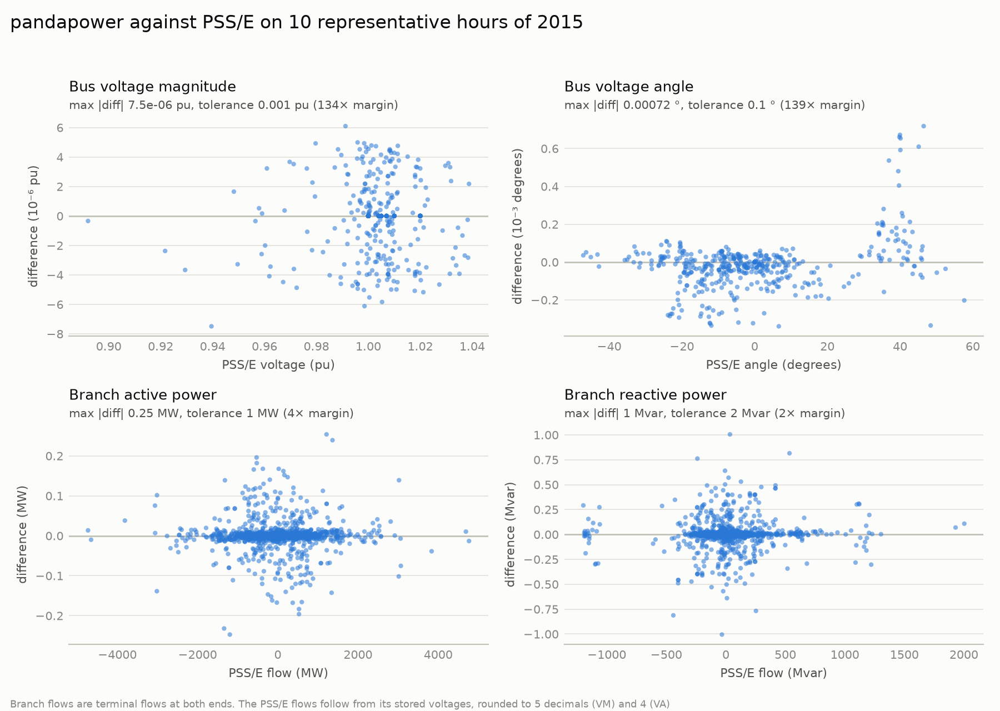

</details>

### Against PowerFactory

PowerFactory 2024 imported the same RAW files with its own PSS/E importer, so its network was
built without this project's parser. It solved 60 hours, the ten representative ones and 50
drawn at random, with options that match the pandapower runs. The table gives the largest
difference between each pair of tools over the 60 hours.

| Pair | \|ΔV\| (p.u.) | \|Δθ\| (°) | branch \|ΔP\| (MW) | branch \|ΔQ\| (Mvar) | slack \|ΔP\| (MW) | hours within tolerance |
|---|---|---|---|---|---|---|
| pandapower against PSS/E | 7.5·10⁻⁶ | 7.2·10⁻⁴ | 0.25 | 1.1 | 0.035 | 60 of 60 |
| PowerFactory as imported, against PSS/E | 8.9·10⁻⁴ | 5.5·10⁻³ | 0.70 | 3.6 | 0.045 | 0 of 60 |
| PowerFactory with exact ratios, against PSS/E | 7.5·10⁻⁶ | 7.2·10⁻⁴ | 0.25 | 1.1 | 0.036 | 60 of 60 |
| PowerFactory with exact ratios, against pandapower | 5.2·10⁻⁸ | 1.3·10⁻⁵ | 3.1·10⁻⁴ | 7.5·10⁻⁴ | 8.2·10⁻⁴ | 60 of 60 |

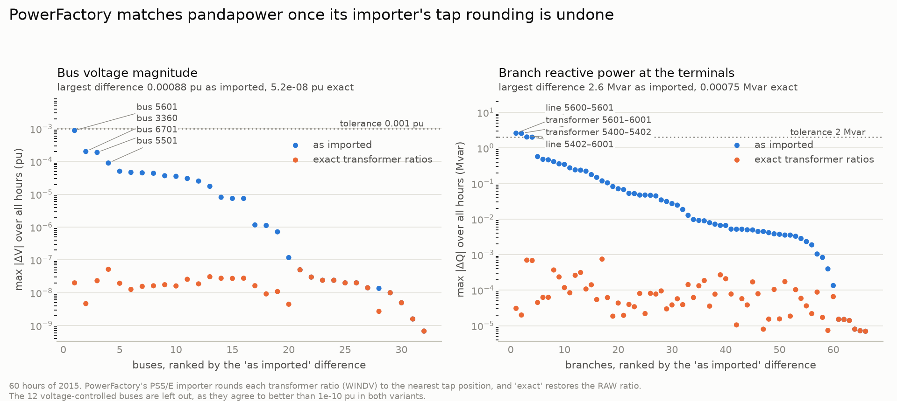

Two modelling decisions explain the differences between the tools, and neither is an error.
PowerFactory's importer rounds transformer ratios to tap positions. The RAW ratios are off
the tap grid by up to 9.5·10⁻⁴, on transformer 5601–6001, which is enough for 8.8·10⁻⁴ p.u. at
bus 5601 and 2.6 Mvar on the branches around it. With the exact ratios, PowerFactory and
pandapower agree to the solvers' convergence tolerance and on which plants end at a reactive
limit. Loading also means different things in the two tools. PowerFactory computes a line's
loading from its series current, while PSS/E uses the terminal current with the end shunts
included, so line 5101–5501 shows 27.5 % in PowerFactory and 60.7 % in PSS/E terms with
identical flows.

The comparison was carried on to the later studies. PowerFactory's contingency analysis on
five critical hours gives the same AC solution, or the same absence of one, in every one of
the 355 outages, and its DC-OPF on three hours matches the cost, the dispatch per technology
and the nodal prices.

### Discrepancies found and explained

Nine discrepancies came up during the validation. None was resolved by tuning, and each is
documented with its evidence in the [validation log](docs/validation_log.md).

1. **The published base case is not a solved power flow.** Generator outputs are off by a
   constant percentage per area (−342 MW in total), the footprint of a per-area rescaling
   after the last solution, so only the after-power-flow files serve as reference.
2. **PSS/E's NMETR names the non-metered winding.** Reading it as the metered end shifted the
   NO2–NO5 interchange by up to 3.4 MW in 4,071 hours.
3. **The toolbox overwrote PSS/E's overload flags.** The Rate A, B and C messages share one
   cell, so 1,780 overloaded hours looked clean. Read as "any rate message", the flag agrees
   with the model in 8,760 of 8,760 hours.
4. **Area interchange targets are missed in some hours** by the data itself. In 48 hours Nord
   Pool's exchanges do not sum to zero, and SE3, which holds the swing bus, absorbs the
   difference.
5. **Larger annual deviations at the two weakest buses**, explained by PSS/E's convergence
   tolerance at buses of low short-circuit strength.
6. **PowerFactory's PSS/E importer rounds transformer ratios to tap positions**, silently, on
   a grid of 0.635 % per step.
7. **Loading means different things in PowerFactory and PSS/E**, series current against
   terminal current and MVA, so comparisons use flows or loading recomputed in one
   convention.
8. **PowerFactory prices energy at its reference machine in the DC-OPF.** Its system lambda
   was the cost of the reference machine although that machine sat at its limit, and its DC
   load flow leaves out the active power of the line-end shunts.
9. **pandapower reports solutions that do not exist after some outages.** Its reactive-limit
   loop can converge with an inconsistent set of limited plants. Such solutions are now
   rejected, and pandapower and the project's solver agree on convergence in 100 of 100
   hours.

### AC against DC power flow

The comparison uses the ten representative hours (`scripts/07_nordpool_dc_comparison.py`).
The plain DC power flow is off by up to 374 MW on a branch, and the worst branch is always one
connected to the slack bus (3200–3300, 3300–8500). A DC power flow has no losses, so the slack
bus picks up all of them, 160 MW to 1.2 GW depending on the hour, and that shifts the flows
around it. The error correlates with loading (rank correlation 0.41) much more than with R/X
(0.16).

Adding each branch's AC losses as loads at its ends, a loss-compensated DC power flow, cuts the
RMSE by 60–70 %. The median relative error on flows above 50 MW drops from 3.5 % to 1.0 %.
What remains sits on the long, heavily loaded north–south lines in SE1/SE2, where voltage
magnitudes and reactive flows depart most from DC's assumptions. DC is therefore acceptable
for screening as long as losses are compensated, but not for absolute flows near the slack or
on the heavily loaded northern corridors.

<details>
<summary>DC and loss-compensated DC against AC</summary>

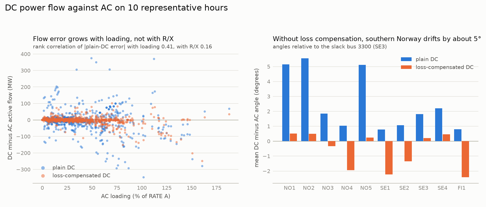

</details>

## Results

Figures are in `results/figures/` and tables in `results/` and `results/validation/`.
`scripts/run_pipeline.py` regenerates all of them.

### P1. How well does N44 reproduce Nord Pool's inter-zonal flows?

Per zone it reproduces them exactly, by construction. Per border it does well only where the
model's topology matches the real border, and the large errors come from the NO1–NO2–NO5 loop
and the two artificial ties of the equivalent.

Each zone's net interchange matches Nord Pool because PSS/E's area interchange control
enforced it when the dataset was built. Every area except SE3 stays within 10.2 MW of its
target. SE3 holds the swing bus and absorbs the residuals, up to 24 MW, and in 48 hours the
Nord Pool targets themselves do not add up, by up to 575 MW. This agreement says nothing about
the model on its own. The table gives the annual mean of |model − Nord Pool| on each border
(`results/border_errors.csv`), leaving out the synthetic hour 2015-03-29 02:00.

| Border | Error | Why |
|---|---|---|
| SE3→FI1 (Fenno-Skan), NO4→FI1 | 0 MW | modelled as loads set from Nord Pool |
| SE3→SE4 | 1.7 MW (mean flow 2,857 MW) | SE4's only AC border, pinned by the interchange control |
| SE1→NO4, SE2→NO4, SE2→NO3, NO4→NO3, NO1→NO3, SE3→NO1 | 60–182 MW | loop flows across the meshed Norway–Sweden interface |
| **NO1→NO2, NO1→NO5, NO5→NO2** | **1,445 MW** on each | a loop round the NO1–NO2–NO5 triangle |
| **SE1→FI1** | **1,191 MW** (bias −1,191) | the artificial SE2–FI tie carries Finland's import |
| **SE1→SE2, SE2→SE3** | 759 and 549 MW | the artificial SE1–SE3 tie bypasses SE2 |

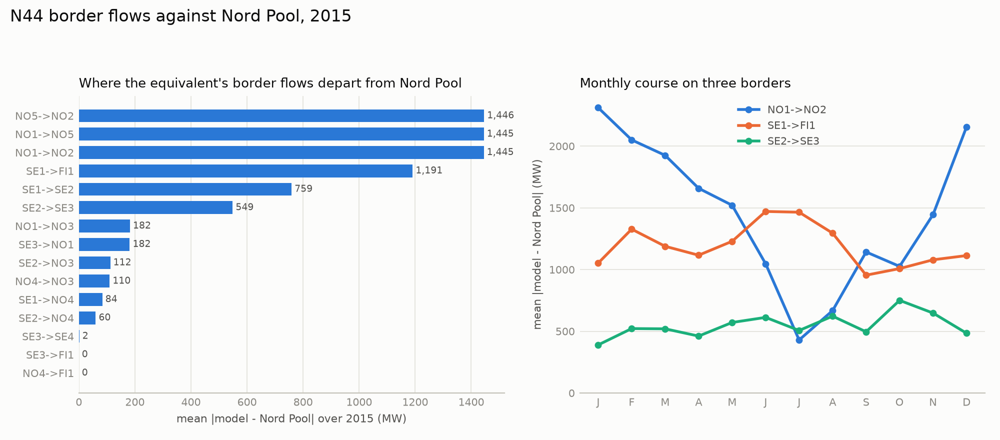

In southern Norway the three errors are equal because the difference is a pure loop flow. In
every hour, d(NO1→NO2) + d(NO1→NO5) stays within 15 MW. In the model, NO2's export to NO1
takes the NO2→NO5→NO1 path, through the two NO2–NO5 transformers at bus 6001, which have very
low impedance (X = 0.0076 and 0.015 p.u.). Nord Pool reports most of it on the direct NO2–NO1
border. The loop is largest in winter (2.3 GW mean error in January) and smallest in July
(0.4 GW).

In Sweden and Finland the artificial ties re-route the flows. On average the model sends about
200 MW from FI to SE1, where Nord Pool reports about 990 MW from SE1 to FI. Measured as a cut
of zone sets instead of a border, the north–south error shrinks. Snitt 2 averages 3,635 MW in
the model against 3,820 MW on Nord Pool's SE2→SE3 (−5 %), and the two duration curves almost
overlap.

N44 is therefore adequate for zone balances, for the SE3–SE4 border and for the Swedish
north–south transfer measured as a cut. It is not adequate for border-level flows in southern
Norway or on SE1–FI, and results there describe the equivalent rather than the real grid.

ENTSO-E's data settle what kind of flow the dataset holds (`results/exchange_type.csv`). On
13 of the 15 borders between modelled zones, Nord Pool's exchange is within 31 MW of
ENTSO-E's physical flow on average, with a correlation of 0.95 or more, and 100 to 340 MW
away from the scheduled exchanges. The dataset holds measured physical flows, so the border
errors above belong to the equivalent and not to a gap between commercial and physical flows.
The two borders that fit less well, NO1→NO2 (176 MW) and NO1→NO5 (49 MW), are in the triangle
where the model's loop sits.

### P2. Which corridors limit the north–south transfer?

In the model, snitt 2 (SE2→SE3) is the binding Swedish cut, followed by snitt 1, and snitt 4
almost never binds. Congestion concentrates in daytime hours, most of all in June, October,
January and November, and the transfer follows northern generation (r = 0.92). The tables are
`results/cut_statistics.csv` and `results/top_overloaded_branches.csv`.

| Cut | Mean | 95th percentile | Max | Nord Pool equivalent |
|---|---|---|---|---|
| snitt 2 | 3,635 MW | 6,271 MW | 7,024 MW | SE2→SE3, mean 3,820 MW, max 7,317 MW |
| snitt 1 | 1,602 MW | 3,070 MW | 3,613 MW | SE1→SE2, mean 480 MW, max 3,023 MW |
| snitt 4 | 2,839 MW | 4,596 MW | 5,307 MW | SE3→SE4, mean 2,841 MW, max 5,307 MW |

Snitt 1 runs higher than Nord Pool because the equivalent feeds Finland from SE2 (see P1).

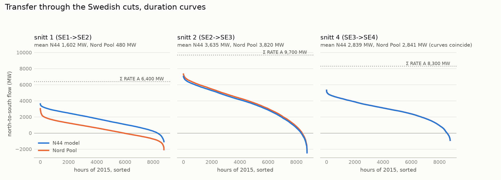

The next table counts the hours in which the most loaded branch of each cut reaches 80, 90 and
100 % of RATE A.

| Cut | ≥ 80 % | ≥ 90 % | ≥ 100 % | Binding branch at 100 % |
|---|---|---|---|---|
| snitt 2 | 4,987 h | 4,055 h | **3,102 h** (35 % of the year) | 3100–3359 circuit 2 (Hjälta–Ringhals), every hour |
| snitt 1 | 3,911 h | 2,575 h | 1,394 h | 3100–3115 (Hjälta–Porjus) in 1,164 h |
| snitt 4 | 699 h | 104 h | 7 h | 3300–8500 (Oskarshamn–Malmö) |

Over the whole network, 4,794 hours (55 %) have at least one branch at or above RATE A, the
same hours PSS/E flagged. The branches overloaded most often are 3100–3249 inside SE2
(3,646 h), 3100–3359 circuit 2 (3,102 h), 5402–6001 between NO1 and NO5 (1,780 h),
transformer 5400–5402 (1,577 h) and transformer 6000–6001 between NO2 and NO5 (1,188 h).

The equivalent's ratings inflate these counts. A 44-bus equivalent concentrates several real
circuits in one branch rated, for instance, 1,200 MVA, so the counts show where the equivalent
concentrates the north–south flow. They are not real operating violations. The capacity the
TSOs gave the day-ahead market in 2015 (ENTSO-E) shows how far apart the two are. On SE2→SE3
it was 6,500 MW in the median hour and 4,400 to 7,100 MW over the year, and the market used
all of it in 610 hours, 555 of them with a higher price in SE3. SE3→SE4 was full in 747 hours
and SE1→SE2 in 15. The real corridors were congested in about 7 % of the year, where the
equivalent's snitt 2 sits at RATE A in 35 %. P3 compares these capacities with the
equivalent's N-1 capability.

Overload hours cluster between 06:00 and 22:00. By month they peak in June (576 h), October
(552), January (506) and November (484), and they are fewest in September (121), April (227)
and July (245). The snitt 2 transfer averages most in October (4,801 MW), June (4,662),
November (4,534) and August (4,466), and least in January (2,393 MW) and at night.

Snitt 2 correlates with SE1 + SE2 generation (Pearson r = 0.92) far more than with Norwegian
generation (0.50) or SE3 demand (0.35). The transfer is pushed by northern, largely hydro,
output more than it is pulled by southern demand, which fits the high-transfer months
coinciding with snowmelt (May–June) and autumn inflow (October–November). Losses average
528 MW (1.3 % of demand) and reach 1,346 MW.

<details>
<summary>Loading of the cut corridors, congestion by month and hour, and what drives snitt 2</summary>

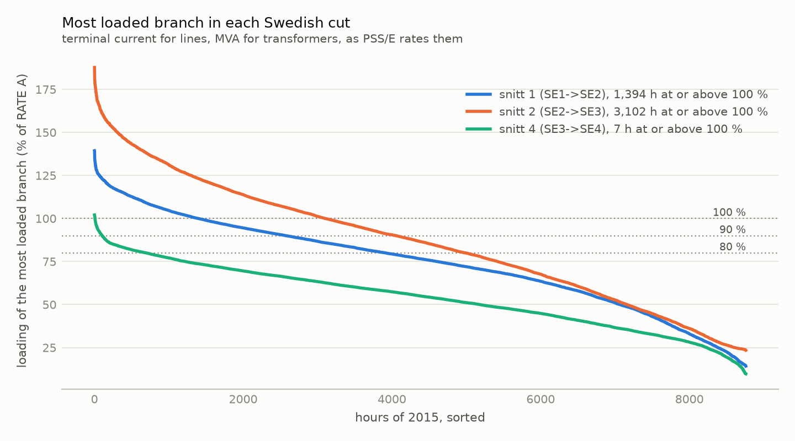

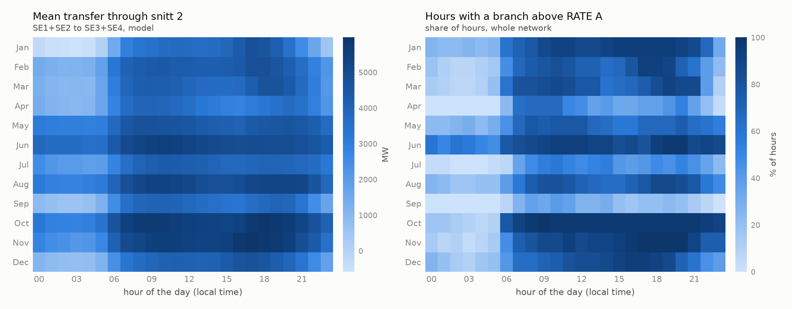

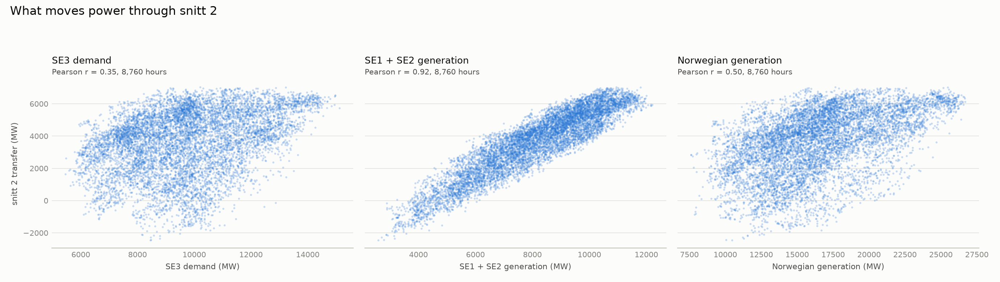

</details>

### P3. Which contingencies are critical, and how much N-1 margin is there?

- The market dispatch of the equivalent is N-1 secure in only 324 hours of 2015.
- Three groups of outages dominate. The Sima transformer in NO5 has no AC solution in most
  hours. Losing one of the SE1/SE2 north–south lines overloads its parallel paths and pulls
  Hjälta down to 0.73 p.u. The third group is the NO1–NO2–NO5 interface.
- Insecurity follows the north–south transfer, with 24.5 insecure outages an hour in the 100
  hours of highest snitt-2 transfer against 2.8 in the 100 lowest.
- Measured from a secure state, snitt 2's N-1 transfer capability is 3.2 GW in the median
  hour, and the market flow is above it in 5,991 hours. In the 100 hours of highest transfer
  the capability is 3.8 GW, 2.9 GW short of the market flow. Snitt 1 and snitt 4 have room to
  spare in all but 141 and 5 hours.

The full AC N-1 covers all 8,760 hours with 71 outages each, 621,960 cases. It ran with the
reference-model solver (`n44.acpf`) in about 45 minutes and was checked twice. Against
pandapower on the 100 hours of highest snitt-2 transfer, the same outages converge in every
hour and post-contingency loading agrees to 1.3·10⁻⁵ percentage points. Against PowerFactory's
own contingency analysis on five critical hours, every one of the 355 outages has the same AC
solution or the same absence of one.

#### What breaks N-1

Of the 621,960 cases, 73,514 (11.8 %) are insecure. They split into 62,548 induced overloads
(a branch beyond RATE B that was within it before the outage), 4,550 cases with a voltage
below 0.90 p.u. and no overload, and 6,416 outages with no AC solution at all. At least one
outage is insecure in 8,436 hours, and over the year an hour has 8.4 insecure outages on
average. Winter is the worst season (13.9 insecure outages an hour in January) and September
the mildest (3.0).

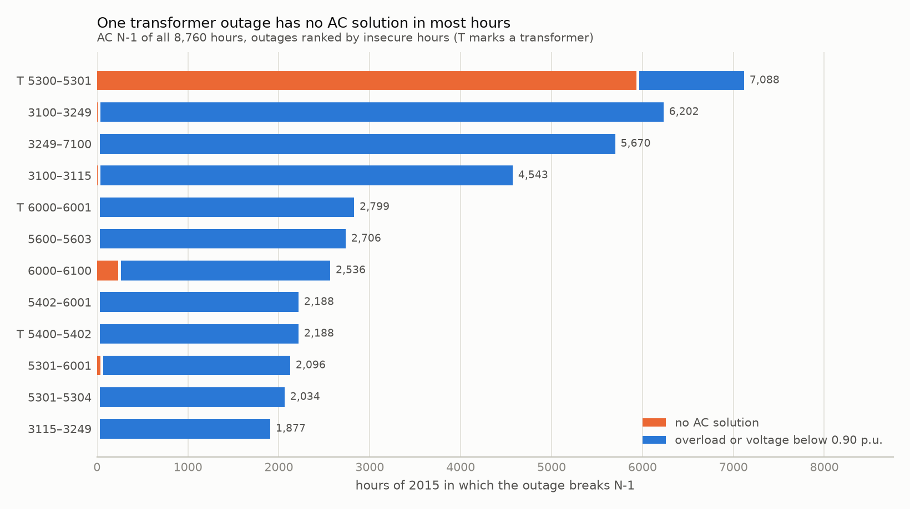

| Outage | Insecure hours | No AC solution | Worst induced overload | Lowest voltage |
|---|---|---|---|---|
| transformer 5300–5301 (Sima–Aurland, NO5) | 7,088 | 5,936 h | line 6000–6100 at 153 % of RATE B | 0.91 p.u. |
| line 3100–3249 (Hjälta–Grundfors, SE2) | 6,202 | 8 h | 3115–3249 at 200 % | 0.82 p.u. at Hjälta |
| line 3249–7100 (Grundfors–Oulu, artificial SE2–FI tie) | 5,670 | 0 | 3115–3249 at 200 % | 0.88 p.u. |
| line 3100–3115 (Hjälta–Porjus, SE1–SE2) | 4,543 | 7 h | 3100–3249 at 162 % | 0.73 p.u. at Hjälta |
| transformer 6000–6001 (NO2–NO5) | 2,799 | 0 | 5400–6000 at 166 % | 0.89 p.u. |
| line 5600–5603 (NO2) | 2,706 | 0 | 5402–6001 at 116 % | 0.80 p.u. at the Skagerrak terminal |
| line 6000–6100 (NO2) | 2,536 | 235 h | 5301–6001 at 161 % | 0.87 p.u. |

The outages fall into three groups.

- **The Sima transformer** has no AC solution in 5,936 hours. Bus 5300 aggregates 4.6–5.1 GW
  of NO5 hydro behind that one transformer, and without it all of the output must leave
  through one 300 kV line (5300–6100, X = 0.22 p.u.), beyond what the line can carry in steady
  state. pandapower and PowerFactory agree that there is no solution. In the real system a
  system-protection scheme would trip generation, and in the equivalent the outage is an
  artefact of aggregation.
- **The SE1/SE2 corridor.** Losing any one of Hjälta–Grundfors, Hjälta–Porjus or the
  artificial Grundfors–Oulu tie overloads the others, up to 200 % of RATE B, and pulls the
  voltage at Hjälta down to 0.73 p.u. These are the lines that carry snitt 1 and 2.
- **The NO1–NO2–NO5 interface.** The transformers at bus 6001 and the lines around them
  overload each other. It is the same loop that distorts the borders in P1.

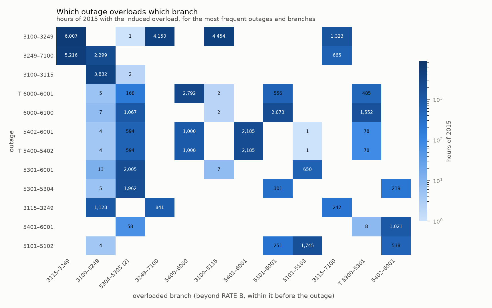

The radial HVDC connections are left out of the list, because losing one would disconnect a
link. The largest import lost is 1.6 GW on Skagerrak (NO2–DK1), 1.5 GW on Vyborg (FI–RU),
1.2 GW on Fenno-Skan (SE3–FI) and 0.3–0.7 GW on Estlink, NorNed, Konti-Skan, Baltic Cable and
SwePol. These are frequency incidents, outside a load-flow study
(`results/n1_hvdc_links.csv`).

#### How good is a DC screening?

The screening estimates each case from the hour's AC flows plus LODF, with the end shunts of a
tripping line accounted for. Against the full AC N-1 the mean absolute loading error is 0.17
points, and 95 % of cases are within 0.66 points. At a 90 % threshold the screening misses 40
of the 62,548 induced overloads (0.06 %) and none of the 6,416 cases without a solution, and
it spares 65 % of the AC runs. At 80 % it misses no overload and spares 40 %. It cannot see
the 4,550 low-voltage cases, because DC has no voltage, so voltage security always needs AC.

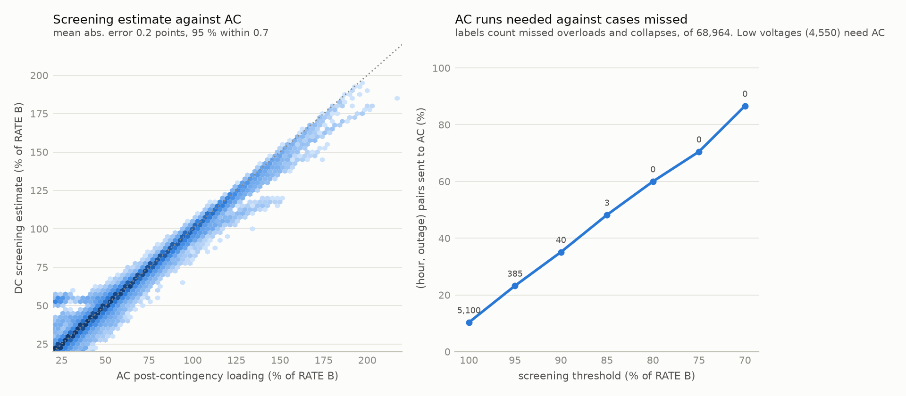

#### N-1 transfer capability of the cuts

Measured from the market dispatch, every cut's N-1 margin would be negative in most hours,
for violations the cut has nothing to do with. So the margin is measured from each hour's
secure state, the market dispatch after the N-1 redispatch of P4. The capability is the cut's
flow in that state plus the part of the remaining margin that crosses the cut. Both it and the
market flow are the mean of the two ends of the crossing branches, and the metered cut flows
of P1 and P2 run 20–50 MW higher in the median hour, by half the crossing branches' losses
(`results/transfer_margins_summary.csv`).

| Cut | N-1 capability, median (p10–p90) | Market flow, median | Hours market above it | Limiting element (share of hours), after the loss of |
|---|---|---|---|---|
| snitt 1 (SE1→SE2) | 3,191 MW (2,131–3,498) | 1,605 MW | 141 | Porjus–Oulu 3115–7100 (58 %), Hjälta–Porjus 3100–3115 |
| snitt 2 (SE2→SE3) | 3,186 MW (1,618–3,996) | 3,882 MW | **5,991** | Porjus–Grundfors 3115–3249 (66 %), Hjälta–Grundfors 3100–3249 |
| snitt 4 (SE3→SE4) | 5,523 MW (3,454–6,169) | 2,961 MW | 5 | Tenhult–Oskarshamn 3200–3300 (44 %), Oskarshamn–Malmö 3300–8500 |

Snitt 2 is the limit. In 72 % of hours the secure state sits exactly at snitt 2's N-1 limit,
and in the 5,991 hours where the market flow is above the capability, it is above by
1,189 MW in the median hour (2,348 MW at the 90th percentile). In the 100 hours with the
highest market flow through snitt 2 (6.5–6.9 GW), the N-1 capability is 3.8 GW in the median
hour (3.5–4.0 GW), 2.9 GW below the market flow. The limit there is Hjälta–Porjus after the
loss of Hjälta–Grundfors (71 of the 100 hours) or the reverse.

The elements that set snitt 2's capability sit north of the cut. They are the SE1/SE2 lines
that dominate the N-1 ranking, not the Hjälta–Ringhals circuits that bind in the intact
network (P2).

The real counterpart of this capability is the capacity the TSOs offered to the day-ahead
market on each cut's border, which ENTSO-E publishes hour by hour (`results/ntc_cuts.csv`).

| Cut | Capacity offered, median (min–max) | Hours the market used all of it | Equivalent's N-1 capability, median | Ratio |
|---|---|---|---|---|
| snitt 1 (SE1→SE2) | 2,900 MW (1,800–3,300) | 15 | 3,191 MW | 0.91 |
| snitt 2 (SE2→SE3) | 6,500 MW (4,400–7,100) | 610 | 3,186 MW | **2.04** |
| snitt 4 (SE3→SE4) | 4,800 MW (2,700–5,200) | 747 | 5,523 MW | 0.87 |

On snitt 1 and snitt 4 the equivalent's capability is within 13 % of what the TSOs offered.
On snitt 2 the TSOs offered twice the equivalent's median capability, and Nord Pool's flow
reached 7,317 MW. The equivalent's SE1/SE2 branches are rated too low for the real snitt 2, so
its 5,991 hours above capability, and the redispatch of P4, overstate what the real 2015 grid
needed.

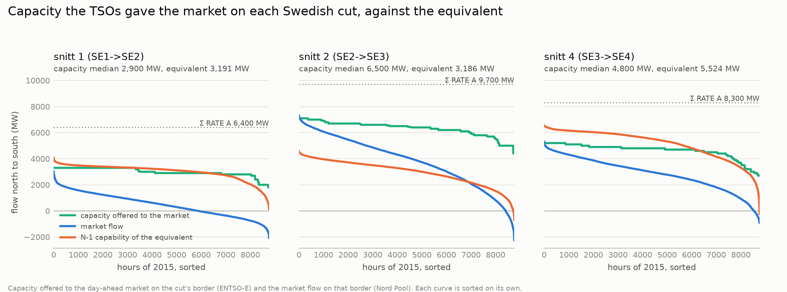

An AC search on the representative hours (`results/transfer_margins_ac_check.csv`) agrees with
DC on snitt 1 and 2, with median N-1 differences of −41 and +9 MW and at most 190 and 299 MW.
On snitt 4, AC finds 291 MW more in the median and up to 1,375 MW, because its limiting lines
meet at the swing bus 3300, which books the transfer's extra losses in AC.

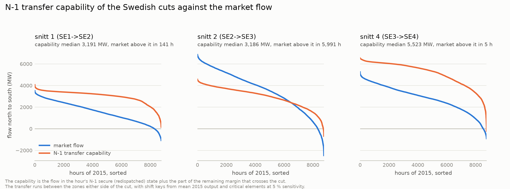

### P4. Nodal prices, and the redispatch the market dispatch needs

Under transparent cost assumptions (nuclear 10, hydro 20, thermal 35 EUR/MWh), the DC-OPF
separates only Finland, which averages 29.2 EUR/MWh against the hydro water value of 20
everywhere else. The real day-ahead prices of 2015 (ENTSO-E) put Finland at 29.7 EUR/MWh and
the other zones between 19.8 and 22.9, so the model finds the one large price step. It misses
the smaller ones. In the market every border separated prices at some point, the
Norway–Sweden borders and NO1–NO3 in 1,500 to 4,100 hours and snitt 2 and snitt 4 in about
660 hours each, while the OPF separates none of them. A single water value lets an OPF route
around every Scandinavian constraint by moving hydro, and real producers value water
differently by zone and by hour.

The redispatch depends less on these assumptions. Making the market dispatch N-1 secure takes
19.2 TWh of redispatch over 2015 (5.6 % of demand), in 8,359 hours, and the intact network
alone takes 5.1 TWh. Almost all of it is countertrade out of the north and western Norway into
SE3, which takes 15.4 TWh more. At an assumed 10–30 EUR/MWh between up- and down-regulation it
would cost 190–570 M EUR. The costs are in `config/costs.yaml`.

#### DC-OPF and nodal prices

The OPF was checked against two other tools. pandapower's `rundcopp` gives the identical cost
on the representative hours, with prices within 10⁻⁹ EUR/MWh, and PowerFactory's DC-OPF on
three hours matches the cost to the cent, the dispatch per technology and the nodal prices.
The network binds in 6,821 hours, but only three branches ever bind, all of them leading into
Finland. Helsinki–Oulu inside FI binds in 5,752 hours, with a mean shadow price of
43 EUR/MWh, and the two ties from SE1 and SE2 in 1,069 hours.

Against the market, the OPF would produce 111 TWh in SE3 instead of 80 TWh, 35 TWh in NO1
instead of 19, and nothing in SE4. The gap measures how far the market dispatch is from a
cost-optimal one under these assumptions, and it is not a forecast. pandapower's AC-OPF on
nine representative hours (one did not converge) adds the loss component. Zone-average prices
move by up to 2.3 EUR/MWh, and SE4, farthest from the marginal hydro, sits about 0.8 EUR/MWh
above the north.

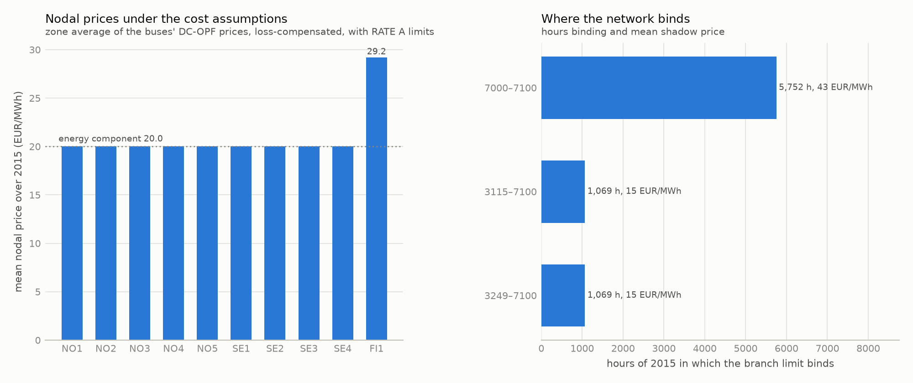

The market's prices are compared in `results/market_prices.csv` and
`results/market_price_borders.csv`. The OPF separates Finland in 6,820 hours, where the market
priced it apart from SE3 in 4,120, and hour by hour the two price differences barely
correlate (0.14). Finland's mean price comes out right partly by chance, because the assumed
costs set it.

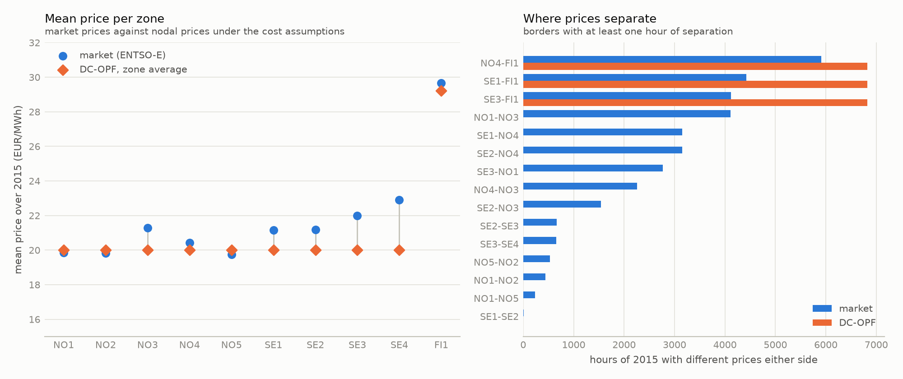

#### Redispatch

`scripts/15_redispatch.py` finds the smallest volume that makes each hour's market dispatch
secure, hour by hour over 2015.

| Criterion | Hours with redispatch | Volume | Between zones | Largest hour | Cost at 10 / 20 / 30 EUR/MWh |
|---|---|---|---|---|---|
| N-0 (RATE A) | 4,671 | 5.1 TWh | 5.1 TWh | 7.8 GW | 51 / 102 / 152 M EUR |
| N-0 and N-1 (RATE B after an outage) | 8,359 | 19.2 TWh | 18.9 TWh | 12.1 GW | 189 / 379 / 568 M EUR |

Every hour has a secure redispatch. The cost range prices the inter-zonal part at an assumed
spread between up- and down-regulation, which gives a scale and does not estimate what
redispatch cost in 2015.

Generation goes down in SE2 (5.7 TWh), NO2 (5.6 TWh) and NO5 (5.4 TWh), and by less in SE1 and
FI1. It goes up in SE3 (15.4 TWh) and NO1 (2.6 TWh). Nearly all of it is inter-zonal, a
countertrade across snitt 2 and out of western Norway rather than a reshuffle inside the
zones. The N-1 redispatch is largest in January (2.2 TWh), when snitt 2 carries least, and
smallest in July (0.9 TWh). NO5 drives the winter redispatch, since the Sima limit below binds
in 696 of January's 744 hours. In the high-transfer months (May–August and October) the
SE1/SE2 limits bind in more hours than Sima's.

The binding limits are post-contingency (`results/redispatch_binding.csv`). They are the
branches of the map at the top of this page.

| Limit on | After the loss of | Hours binding |
|---|---|---|
| line 6000–6100 (Kvilldal–Blåfalli, NO2) | transformer 5300–5301 (Sima) | 6,387 |
| line 3115–3249 (Porjus–Grundfors) | line 3249–7100 (Grundfors–Oulu) | 3,193 |
| line 3115–3249 | line 3100–3249 (Hjälta–Grundfors) | 3,098 |
| line 3100–3115 (Hjälta–Porjus) | line 3100–3249 | 2,560 |
| line 3115–7100 (Porjus–Oulu) | line 3249–7100 | 2,467 |
| line 5100–5500 (Tretten–Oslo2, NO1) | line 5101–5501 (Hasle–Skien) | 2,299 |

The first comes from the Sima transformer, the aggregation artefact of P3. To survive its
loss, the NO5 hydro behind it must be held back. Leaving the Sima outage out of the N-1 set
(`results/redispatch_sensitivity.csv`) cuts the redispatch from 19.2 to 11.1 TWh, in 7,370
hours. NO5's reduction falls from 5.4 to 0.9 TWh and NO2's from 5.6 to 1.9 TWh, while SE2's
barely moves, from 5.7 to 5.8 TWh. The Swedish north–south part of the redispatch therefore
does not depend on the equivalent's aggregation, and most of the Norwegian part does.

The AC check (`results/redispatch_ac_check.csv`) re-ran 110 hours, the representative ones and
100 at random, with a full AC N-1. Before the redispatch, 107 of them were insecure, 66 with an
outage that has no AC solution. After the DC redispatch every outage has a solution, but 104
hours keep small overloads, and the worst outage reaches 107 % of RATE B in the median hour and
112 % at most. The redispatch drives flows exactly to their limits, where the reactive flows
and voltages that the DC estimate holds fixed make the difference. Re-linearising the program
around the AC states removes these overloads, in one round in 101 hours. After that, 107 of
the 110 hours are N-1 secure in AC. The other three keep one overload on the radial Estlink
connection (7000–7020, up to 106 % of RATE A), which carries a fixed exchange that no
redispatch can change. The correction adds 12.8 % to the volume, so if the sample is
representative, the redispatch that is secure in AC is about 21.7 TWh.

The volume measures the distance between the market's flows and the equivalent's N-1 limits.
The equivalent's corridor ratings are lower than the real system's, so the volume overstates
the real redispatch. What carries over is where and when it is needed.

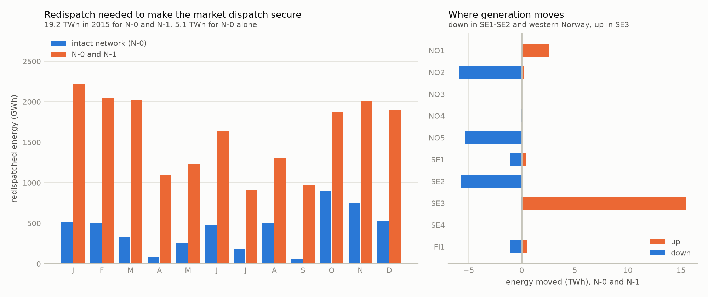

### P5. Reinforcements and new northern demand

- **Reinforcing where the intact network binds does little for N-1.** A third Hjälta–Ringhals
  circuit, on snitt 2's binding branch in the intact network, cuts the N-0 redispatch by 13 %
  but leaves the N-1 redispatch where it was (+0.3 %). A VSC link on the same route cuts it by
  2 %.
- **Reinforcing at the N-1 bottleneck works.** A second Hjälta–Grundfors circuit cuts the N-1
  redispatch by 23 %. It raises snitt 2's median N-1 capability from 3.2 to 5.0 GW, and the
  market flow is then above it in 1,301 hours instead of 6,059. A 1,200 MW VSC link from
  Grundfors to Ringhals cuts the N-1 redispatch most, by 29 %, but adds only 0.6 GW to
  snitt 2's median capability, because the link's own trip is one more contingency.
- **New northern demand first relieves the grid and then loads it the other way.** Up to 3 GW
  of new industrial load in SE1/SE2 lowers the N-1 redispatch, by up to 7 % at 2 GW. At 4 GW
  it is back at the 2015 level, and beyond that it rises, with snitt 2 turning around at about
  6 GW. The 2015 network can still be made N-1 secure by redispatch with 6 GW of new load. At
  8 GW redispatch cannot remove every overload in 5 of the 1,252 hours, and at 10 GW it fails
  in 9 % of them, with 32 more hours that have no AC solution at all.
- **New northern wind**, added to 5 GW of new load and held at a fixed output, keeps the N-1
  redispatch near the 2015 level at 4 GW (+3 %). With 8 GW the redispatch nearly doubles
  (+86 %), with overloads that redispatch cannot remove in 34 hours. Following the real wind
  of 2015 instead, 10 GW installed (3.4 GW on average) need 17 % more than the 2015 network,
  13 % more than the fixed 4 GW.

Every scenario goes through the chain of P3 and P4 on every seventh hour of 2015 (1,252 hours,
`scripts/16_scenarios.py`, `results/scenario_comparison.csv`). On the 2015 network the sample
reproduces the annual redispatch of P4 to 0.4 % for N-1 (19.28 against 19.20 TWh) and 0.1 %
for N-0. The market dispatch is held, and new load is produced by the other zones in
proportion to their output.

#### Reinforcing snitt 2

| Option | N-0 redispatch | N-1 redispatch | Snitt 2 N-1 capability, median | Hours market above it | Losses after redispatch |
|---|---|---|---|---|---|
| 2015 network | 5.08 TWh | 19.28 TWh | 3,223 MW | 6,059 | 330 MW |
| third AC circuit Hjälta–Ringhals | −13 % | +0.3 % | 3,218 MW | 6,087 | −4 % |
| 1,200 MW VSC link Hjälta–Ringhals (842 MW on average) | −16 % | −2 % | 3,185 MW | 5,961 | +20 % |
| second AC circuit Hjälta–Grundfors | −9 % | **−23 %** | **4,990 MW** | **1,301** | +8 % |
| 1,200 MW VSC link Grundfors–Ringhals (891 MW on average) | **−57 %** | **−29 %** | 3,790 MW | 5,472 | +7 % |

Losses are the mean over the 97 hours checked in AC after the redispatch, with the converters'
2 % for the links.

The bottleneck moves. With the second Hjälta–Grundfors circuit, Porjus–Grundfors drops out of
the binding limits and Hjälta–Ringhals circuit 2 takes its place (501 of the 1,252 hours). The
two reinforcements complement each other, since once the northern bottleneck is gone, the
corridor south of Hjälta binds. No Swedish reinforcement touches the NO5 limit behind the Sima
transformer (876–912 hours in every option).

The links behave differently from the lines. A link's set-point follows each hour's needs,
which is why the Grundfors–Ringhals link cuts the redispatch most and nearly removes the N-0
part. Its trip, though, puts its flow back on the AC network, and that caps the transfer a
secure state can carry. At the 10th percentile snitt 2's capability with the link is 949 MW,
lower than without it. With the Hjälta–Ringhals link, the AC circuit beside it,
Hjälta–Ringhals 2, sits at its intact-network limit in 816 hours. The link and the circuit
share the transfer south of Hjälta, while the N-1 limits north of it stay where they were.

After the DC redispatch, the AC N-1 finds 2.0 to 2.7 insecure outages per checked hour (2.6 on
the 2015 network) and none without an AC solution. The AC correction of P4 removes that
residual at about 13 % more volume.

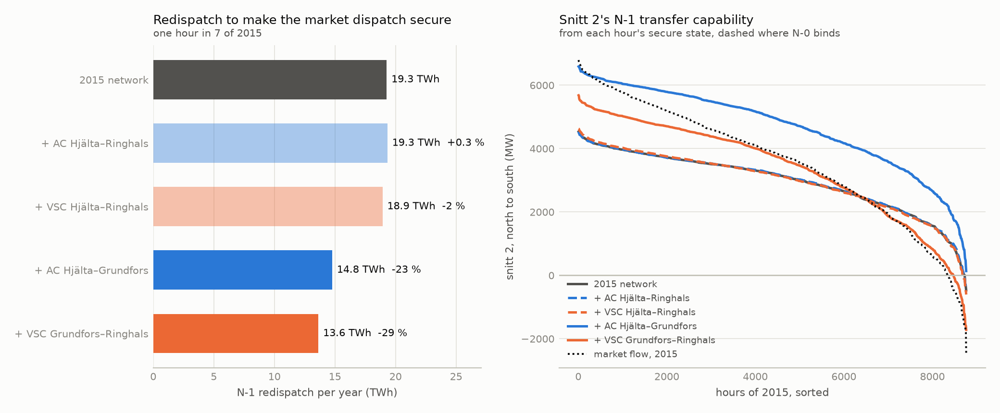

#### New industrial load in SE1/SE2

The new load sits 60 % at Porjus and 40 % at Grundfors, with power factor 0.95.

| New load | N-0 redispatch | N-1 redispatch | Snitt 2, mean flow | Hours N-1 cannot be restored |
|---|---|---|---|---|
| 0 (2015) | 5.08 TWh | 19.28 TWh | 3,640 MW | 0 |
| 1 GW | 3.33 TWh | 18.13 TWh | 3,069 MW | 0 |
| 2 GW | 2.63 TWh | 17.86 TWh | 2,485 MW | 0 |
| 3 GW | 2.77 TWh | 18.31 TWh | 1,891 MW | 0 |
| 4 GW | 3.69 TWh | 19.38 TWh | 1,284 MW | 0 |
| 5 GW | 5.25 TWh | 20.90 TWh | 667 MW | 0 |
| 6 GW | 7.38 TWh | 22.81 TWh | 39 MW | 0 |
| 8 GW | 14.79 TWh | 28.90 TWh | −1,251 MW | 5 |
| 10 GW | 25.49 TWh | 41.98 TWh | −2,498 MW | 108, and 32 without an AC solution |

The flows turn around. Snitt 1 reverses at about 4 GW of new load and snitt 2 at about 6 GW,
while snitt 4 hardly changes. New northern load first absorbs the surplus that loads the
north–south corridors. Beyond 6 GW the corridors carry power north, and the limits become the
paths that feed the north. They are the ties into Porjus from Norway (Ofoten) and Finland
(Oulu), Porjus–Grundfors again, and Tenhult–Oskarshamn in SE3. The 2015 network was built to
export from the north.

#### With new wind

These cases add wind at Porjus and Grundfors to 5 GW of new load, held at a fixed output or
following the real wind of 2015.

| Case | N-0 redispatch | N-1 redispatch | Snitt 2, mean flow | Hours N-1 cannot be restored |
|---|---|---|---|---|
| 5 GW of new load | 5.25 TWh | 20.90 TWh | 667 MW | 0 |
| with 4 GW of wind | 3.76 TWh | 19.91 TWh | 3,056 MW | 0 |
| with 8 GW of wind | 21.54 TWh | 35.93 TWh | 5,227 MW | 34, and 3 without an AC solution |
| with 10 GW of wind on the 2015 profile (3.4 GW on average) | 6.79 TWh | 22.50 TWh | 2,701 MW | 10, and 2 without an AC solution |

With 8 GW of wind the north exports more than in 2015, and snitt 1 becomes a limit too (its
market flow is above its N-1 capability in 1,845 hours).

The last case follows the real wind of SE1 and SE2 in 2015 (ENTSO-E), scaled so that its
windiest hour gives the 10 GW installed. It produces 3.4 GW on average, close to the 4 GW
case, yet it needs 13 % more N-1 redispatch than that case and 81 % more N-0 redispatch. In
windy hours the north pushes past the bottleneck as in the 8 GW case, and in calm hours the
new load draws on the south, and the two do not cancel. Wind held at its mean output
therefore understates the redispatch.

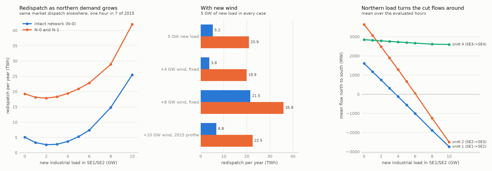

### P7. The 2015 grid with the flows of 2025

It cannot carry them securely. Snitt 2's mean flow rises from 3.6 to 5.6 GW, the market
dispatch is N-1 secure in 121 hours instead of 324, and in 17 hours of January and February
the intact grid has no AC solution at all.

The snapshots of 2025 come from ENTSO-E's actual load and generation per zone and its
physical flows on every border, fitted with the dataset's own method, written again on the
project's solver (`scripts/20_fit_snapshots.py`, details in
[docs/methods.md](docs/methods.md#snapshots-fitted-to-market-data)). On the dataset's own
Nord Pool data for 2015 the method reproduces the dataset's snapshots, with the snitt flows
within 27 MW in 99 % of hours and nearly always the same taps
(`results/fitting_check_2015.csv`). pandapower then re-solves the fitted hours of 2025 to
1.4·10⁻⁹ p.u. The 2015 topology and machines are kept, so the generation of 2025 sits on the
2015 equivalent's machines.

Between the two years the north exports more and the south imports more. SE2's net export
grows from 31.8 to 39.1 TWh and SE1's from 12.4 to 15.7 TWh, while SE3's net import doubles
from 5.7 to 11.5 TWh. Finland's import falls from 16.1 to 5.2 TWh, with Olkiluoto 3 in
service.

| Over the year | 2015 | 2025 |
|---|---|---|
| Snitt 1, mean flow | 1,602 MW | 2,471 MW |
| Snitt 2, mean flow (95th percentile) | 3,635 MW (6,271 MW) | 5,605 MW (7,300 MW) |
| Snitt 4, mean flow | 2,839 MW | 3,303 MW |
| Hours snitt 2 is above its 2015 median N-1 capability (3.2 GW) | 5,569 | 8,331 |
| Hours with a branch above RATE A | 4,794 | 8,200 |
| Losses, mean | 528 MW | 962 MW |
| Hours N-1 secure | 324 | 121 |
| Insecure outages per hour, mean | 8.4 | 23.6 |
| Outages with a voltage below 0.90 p.u. and no overload | 4,550 | 55,884 |
| Hours with no AC solution before any outage | 0 | 17 |

The 2025 counts cover the 8,743 hours with an AC solution (`results/year2025_summary.csv`).
The model's snitt 2 flow agrees with the market data, as ENTSO-E's physical SE2→SE3 flow
averaged 5,771 MW in 2025. In the 17 hours without a solution the real flow averaged 7.5 GW.
The real corridor carried it, so these hours show where the equivalent's snitt 2 is short,
as P3 found from the offered capacities, more than they show a limit of the real grid.

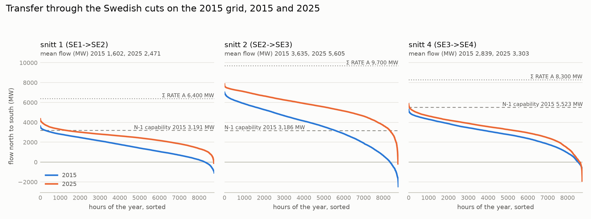

Hjälta–Grundfors is still the worst outage, insecure in 8,449 hours
(`results/year2025_n1_ranking.csv`). Behind it come Kristiansand–Kvilldal (5600–6000) in NO2,
up from 1,702 to 7,346 hours, and Hjälta–Porjus. Southern Norway rises in the ranking, and
there the export on NO2's links to Germany and Britain, built after 2015, is modelled as
demand at its loads. Insecurity gathers in winter, with 54 and 58 insecure outages per hour
in January and February against 14 and 13 in 2015, and outages with a low voltage alone
become twelve times as many.

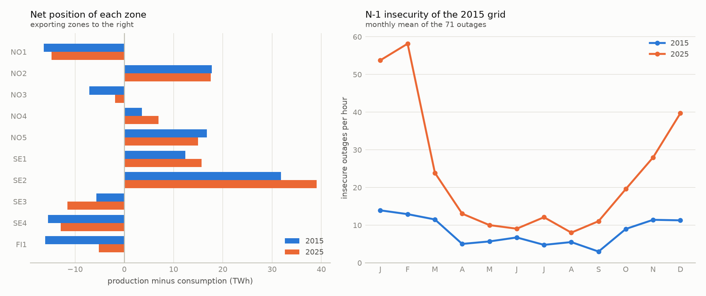

## Conclusions

The equivalent's ratings are not the real limits, so its volumes and hours describe the
equivalent rather than the 2015 system. What carries over is the method and the structure of
the answers. The study shows which elements bind under N-1, why a cut's limit can sit outside
the cut, and how far a linear screening can be trusted. pandapower and PowerFactory, built
independently from the same files, agree to their convergence tolerance and both reproduce
PSS/E to the rounding of its files, and every difference between the tools traces back to a
documented modelling convention. ENTSO-E's data put numbers on the equivalent's limits, which
hold on snitt 1 and snitt 4 and fall short by half on snitt 2, and they let the dataset's
method rebuild a recent year on the same grid.

## Limitations and next steps

- **N44 is a 44-bus equivalent.** Its branch ratings are not the real corridor limits, and
  each generator bus aggregates many plants. Overloads, N-1 violations and redispatch volumes
  show where the equivalent concentrates flow, and they do not describe real operating
  violations. On snitt 2 the TSOs offered the market twice the equivalent's median N-1
  capability in 2015 (6.5 against 3.2 GW), while on snitt 1 and snitt 4 the two are within
  13 %.
- **The annual run re-analyses PSS/E's solution of each hour.** Taps, area-slack outputs and
  voltage setpoints come from PSS/E, so the run is not an independent dispatch.
- **Costs are assumptions** (nuclear 10, hydro 20, thermal 35 EUR/MWh). The nodal prices are
  therefore only structural, and the redispatch is reported as volume.
- **Some data are not public.** ENTSO-E holds no Nordic redispatch or countertrade volumes
  for 2015, so the redispatch of P4 has nothing real to be compared with.
- **The 2025 snapshots keep the 2015 grid.** New lines such as SydVästlänken and the Aurora
  Line are missing, and each zone's 2025 generation, wind included, sits on the 2015
  equivalent's machines in proportion to their output (P7).

## Reproducing the results

The pipeline needs Python 3.12. Three commands set up the environment, run the pipeline and
run the tests.

```powershell
# Windows
python -m venv .venv; .venv\Scripts\python -m pip install -r requirements.txt -e .
.venv\Scripts\python scripts/run_pipeline.py
.venv\Scripts\python -m pytest
```

```bash
# Linux and macOS
python3 -m venv .venv && .venv/bin/python -m pip install -r requirements.txt -e .
.venv/bin/python scripts/run_pipeline.py
.venv/bin/python -m pytest
```

On a fresh clone the pipeline takes about three hours with the default three worker
processes, each of which can take about 1.2 GB of memory. It downloads the dataset (about
530 MB, MD5-checked), checks every PSS/E solution, builds the hourly tables and solves the
year (`--workers N`, 3 by default). Then it runs the N-1 analysis, the OPF, the redispatch, the
transfer capability and the scenarios, and regenerates every figure and table. Steps already
done are skipped, and `--force` runs them again.

PowerFactory is optional. The comparisons read the PowerFactory results committed in
`powerfactory/exports/`, and `--powerfactory` re-runs PowerFactory first.

The steps on ENTSO-E data (18 to 21) need a free token from the ENTSO-E Transparency Platform
in the `ENTSOE_API_KEY` environment variable, set up as described in
[data/README.md](data/README.md#entso-e-data). Without it they are skipped and everything else
runs. The first download takes about half an hour, and fitting and analysing 2025 about
another hour.

## PowerFactory projects

`powerfactory/Nordic44_2015.pfd` holds the base case and twelve hours of 2015 as PowerFactory
projects, imported with PowerFactory's own PSS/E importer. They open without Python in
PowerFactory 2024 SP2 or newer.

1. Import the file with File > Import > Data.
2. Activate a project, for example `N44_h0538`, the winter peak of 2015.
3. Run the load flow, the contingency analysis (71 outages) and the DC optimal power flow from
   the Calculation menu. The settings of the comparison are already in place.

Each project has the exact transformer ratios of its RAW file, the cost assumptions and the
same single-line diagram, laid out like the map with each bidding zone in its own colour.
[powerfactory/README.md](powerfactory/README.md) shows the diagram, lists the projects and the
values each study should give, and explains how the projects and the exported results were made.

## Repository layout

```text
config/        paths, solver options, tolerances, cost assumptions, scenarios
data/          dataset documentation (raw and processed data are downloaded or generated)
docs/          methods and validation log
src/n44/       PSS/E parser, reference model, pandapower builder, AC solver, N-1, OPF,
               redispatch, scenarios, ENTSO-E client, snapshot fitting, validation, figures
scripts/       numbered pipeline steps and run_pipeline.py
powerfactory/  PowerFactory projects (.pfd), the scripts that drive PowerFactory, and its results
results/       figures and summary tables
tests/         pytest suite on small fixtures from the dataset
```

## Data, licences and references

- The code is under the MIT licence (see `LICENSE`).
- The dataset is L. Vanfretti et al., *Nordic44 – 2015 Powerflow Data*, Zenodo,
  [doi:10.5281/zenodo.162907](https://doi.org/10.5281/zenodo.162907), licensed
  **CC BY-NC 4.0**. The pipeline downloads it. This repository redistributes only what is
  derived from it in small form, the test fixtures in `tests/data/`, the PowerFactory projects
  and the PowerFactory results in `powerfactory/`, all under the same licence. Details are in
  [data/README.md](data/README.md).
- The market data of 2015 and 2025 come from the
  [ENTSO-E Transparency Platform](https://transparency.entsoe.eu), under its terms of use. The
  pipeline downloads them with the user's own token, and only tables and figures derived from
  them are committed.
- Bus coordinates for the maps come from the original toolbox,
  [ALSETLab/Nordic44-Nordpool](https://github.com/ALSETLab/Nordic44-Nordpool) (GPL-3.0). They
  are fetched at run time and not stored here.
- If you use this work, please cite the dataset paper and the paper that first presented the
  model.
  - L. Vanfretti et al., "An open data repository and a data processing software toolset of an
    equivalent Nordic grid model matched to historical electricity market data",
    *Data in Brief* 11 (2017) 349–357, doi:10.1016/j.dib.2017.02.021.
  - L. Vanfretti, T. Rabuzin, M. Baudette, M. Murad, "iTesla Power Systems Library (iPSL): A
    Modelica library for phasor time-domain simulations", *SoftwareX* (2016),
    doi:10.1016/j.softx.2016.05.001.
