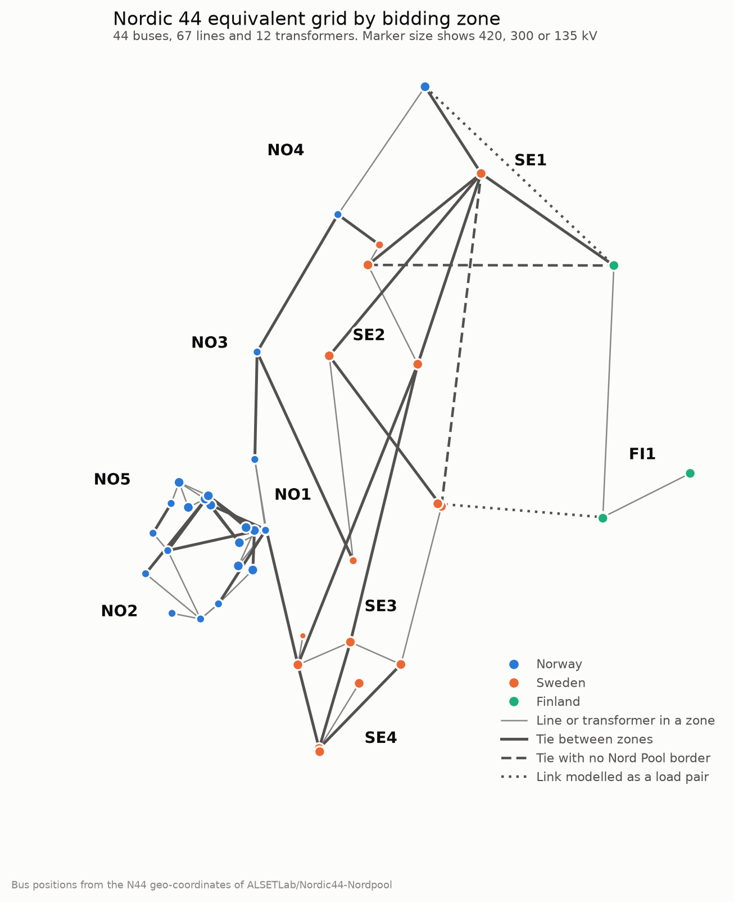

# Data

Raw data is downloaded into `data/raw/` and derived data is written to `data/processed/`.
Neither folder is versioned. Everything below was checked with `scripts/02_inventory.py` and
the PSS/E consistency checks.

## Sources

| Data | Source | Licence | Use |
|---|---|---|---|
| Hourly PSS/E snapshots of 2015 and daily Nord Pool files | Zenodo record [162907](https://doi.org/10.5281/zenodo.162907), *Nordic44 – 2015 Powerflow Data* (Vanfretti et al.), in 53 weekly archives `Week1.zip` … `Week53.zip` | CC BY-NC 4.0 | All analyses |
| Base case `N44_BC.raw` | Same record, `Models.zip` → `PSSE Base case/` | CC BY-NC 4.0 | Tests and reference |
| Bus coordinates `N44_Geo_Coordinates_20151015.xlsx` | [ALSETLab/Nordic44-Nordpool](https://github.com/ALSETLab/Nordic44-Nordpool) | GPL-3.0 | Maps only, fetched at run time and never committed |
| Prices, capacities, flows, load and generation of 2015 and 2025 | [ENTSO-E Transparency Platform](https://transparency.entsoe.eu), REST API | ENTSO-E's terms of use, with attribution | Market comparisons (P1–P4), wind profile (P5), 2025 snapshots (P7), downloaded with a free token and never committed |

`python scripts/01_download_data.py` downloads about 527 MB into `data/raw/` and checks every
archive against the MD5 published by Zenodo. `iTesla_Platform.zip` (Modelica, April–July only)
is not needed and is skipped.

Each weekly archive holds one folder per day, `N44_YYYYMMDD/`, with `CIMSnapshots/`,
`ModelicaSnapshots/` and `PSSESnapshots/`. Only `PSSESnapshots/` is used, and its files are
read straight from the archives (the CIM files alone would take about 11 GB on disk).

## Inventory

| Item | Value |
|---|---|
| Days | 365, from 2015-01-01 to 2015-12-31 |
| Snapshot files | 8,760 `hN_before_PF.raw` and 8,760 `hN_after_PF.raw`, none missing |
| Format | PSS/E RAW revision 33, written by PSS/E 33.5 in two batches (5,856 files stamped 2015-12-08, 11,664 stamped 2016-02-21) |
| System base, frequency | SBASE = 1000 MVA in every file, 50 Hz |
| Excel files per day | 10, namely `Consumption_`, `Production_`, `Exchange_` × `FI`, `NO`, `SE`, plus `PSSE_in_out.xlsx` |

Snapshots are indexed as `h = 24 * (day_of_year - 1) + N`, where `N` is the hour in the file
name, the Nord Pool hour in local time (CET/CEST). `h` runs from 0 to 8759.

## The model in each snapshot

The model has 44 buses, 28 at 420 kV, 15 at 300 kV and 1 at 135 kV. Of these, 26 are PQ and
17 PV, and the swing bus is 3300 OSKARSHAMN. There are 48 loads, 35 demand loads and 13
exchange loads (below), plus 80 machine records, 67 lines and 12 two-winding transformers.
There are no fixed or switched shunts and no DC links. The PSS/E area of each bus is its
Nord Pool bidding zone.

| Area | Zone | Buses |
|---|---|---|
| 11 | NO1 | 5100, 5101, 5103, 5400, 5401, 5402, 5500, 5501 |
| 12 | NO2 | 5600, 5601, 5602, 5603, 5610, 5620, 6000, 6100 |
| 13 | NO3 | 6500 |
| 14 | NO4 | 6700, 6701 |
| 15 | NO5 | 5102, 5300, 5301, 5304, 5305, 6001 |
| 21 | SE1 | 3115 |
| 22 | SE2 | 3100, 3244, 3245, 3249, 3701 |
| 23 | SE3 | 3000, 3020, 3200, 3300, 3359, 3360 |
| 24 | SE4 | 8500, 8600, 8700 |
| 31 | FI1 | 7000, 7010, 7020, 7100 |



### Exchange loads

HVDC links, and a few AC exchanges, are represented as loads (PSS/E `SCALE = 0`), set every
hour to minus the Nord Pool exchange, with power factor 0.95 (0.99 for bus 5610). The mapping
is the one in the original toolbox (`nordic44/n44.py`).

| Bus, load id | Zone | Represents | Nord Pool column |
|---|---|---|---|
| 3020 '1' | SE3 | Fenno-Skan, SE3 side | `SE3_FI` |
| 7000 '6' | FI1 | Fenno-Skan, FI side | `FI_SE3` |
| 6701 '1' | NO4 | NO4–FI AC exchange, NO side | `NO_FI` |
| 7100 '3' | FI1 | NO4–FI AC exchange, FI side | `FI_NO` |
| 3360 '1' | SE3 | Konti-Skan (SE3–DK1) | `SE3_DK1` |
| 5610 '1' | NO2 | Skagerrak (NO2–DK1) | `NO_DK` |
| 5620 '1' | NO2 | NorNed (NO2–NL) | `NO_NL` |
| 6701 '3' | NO4 | NO4–RU | `NO_RU` |
| 7010 '1' | FI1 | FI–RU (Vyborg) | `FI_RU` |
| 7020 '1' | FI1 | Estlink (FI–EE) | `FI_EE` |
| 8500 '4' | SE4 | SE4–DK2 (Öresund, AC) | `SE4_DK2` |
| 8600 '1' | SE4 | Baltic Cable (SE4–DE) | `SE_DE` |
| 8700 '1' | SE4 | SwePol (SE4–PL) | `SE_PL` |

The first two pairs are links inside the modelled system. Fenno-Skan and the NO4–FI exchange
therefore cross a zone border without any branch, and their flow has to be added to the border
flows.

### Nord Pool borders in the model

| Nord Pool border | Representation in N44 |
|---|---|
| NO1–NO2 | lines 5400–6000, 5401–5602, 5500–5603 |
| NO1–NO3 | line 5100–6500 |
| NO1–NO5 | lines 5101–5102, 5102–5103, 5103–5304 (×2), 5401–6001, 5402–6001 |
| NO2–NO5 | line 5300–6100 and transformers 5601–6001, 6000–6001 |
| NO3–NO4 | lines 6500–6700 (×2) |
| NO1–SE3 | lines 3359–5101 (×2) |
| NO3–SE2 | line 3244–6500 |
| NO4–SE1 | line 3115–6701 |
| NO4–SE2 | line 3701–6700 |
| SE1–SE2 | lines 3100–3115, 3115–3245, 3115–3249 |
| SE2–SE3 | lines 3000–3245 (×2), 3100–3200 (×3), 3100–3359 (×2) |
| SE3–SE4 | lines 3200–8500, 3300–8500 (×2), 3359–8500 (×2) |
| SE1–FI | line 3115–7100 |
| SE3–FI | exchange-load pair 3020 / 7000 '6' |
| NO4–FI | exchange-load pair 6701 '1' / 7100 '3' |
| *(none)* | **artificial ties of the equivalent**, 3000–3115 (SE3–SE1) and 3249–7100 (SE2–FI) |

## How the snapshots were built

This summary comes from the dataset paper (Vanfretti et al., *Data in Brief*, 2017) and the
original toolbox (`ALSETLab/Nordic44-Nordpool`, `nordic44/n44.py`). The toolbox drives
PSS/E 33 through its Python API (`psspy`), so it cannot run without a PSS/E licence. This
project only reads the files it produced.

`N44_BC` is a 44-bus equivalent of the Nordic synchronous grid, originally from Statnett and
KTH (first published in iPSL, 2016). Its buses were renamed after nearby towns and grouped into
the ten Nord Pool bidding zones of the time, one PSS/E area per zone. Neighbouring systems
(DK1, DK2, NL, DE, PL, EE, RU) are not modelled, and each link to them is a load at its
connection bus. For every day of 2015 the dataset has Nord Pool's hourly data per bidding
zone, with consumption and production in MWh/h and the exchange on every border, internal and
external. Each hour was built in six steps.

1. The 13 exchange loads are set to minus the Nord Pool exchange on their border, with Q from
   a fixed power factor. Fenno-Skan and NO4–FI have one load on each side, with opposite
   signs.
2. The desired net interchange (PDES) of each area is set to the sum of its Nord Pool
   exchanges on borders inside the model.
3. `psspy.scal_2` scales, in each area, the scalable loads to Nord Pool consumption plus the
   exchange loads, and generation to Nord Pool production.
4. The case is saved as `hN_before_PF.raw`.
5. PSS/E runs a full Newton-Raphson power flow, `fnsl([1, 2, 0, 0, 1, 0, 0, 0])`, with
   transformer tap stepping on, area interchange control on (counting tie lines and loads),
   switched-shunt adjustment on (the model has none), a warm start and reactive limits
   applied. The interchange control adjusts the area-slack machines until each area's
   interchange matches its PDES.
6. If PSS/E converged, the case is saved as `hN_after_PF.raw` and the hour's results go to
   `PSSE_in_out.xlsx`. They are production, consumption and interchange per area, plus flags
   for voltage, generator and branch-rating problems.

Each day starts again from `N44_BC`, and within a day every hour starts from the previous one.
This has four consequences for the analysis.

- All 8,760 hours converged in PSS/E.
- The net interchange of every zone matches Nord Pool by construction, up to the interchange
  tolerance. How well the model reproduces Nord Pool can therefore only be judged per border
  and per cut, not per zone.
- `after_PF` already contains the taps chosen by PSS/E and the slack machines adjusted by the
  interchange control. Solving that same case in pandapower with every control fixed is a
  like-for-like comparison, which `before_PF` would not be.
- `n44.py` names bus 3500 as the area slack of SE3, a bus the model does not have. The files
  keep 3300 as the SE3 area slack.

## Before and after the power flow

`hN_before_PF.raw` holds the case after loads and generation were scaled to the Nord Pool
data. It is not a solved power flow.

`hN_after_PF.raw` holds the PSS/E solution, which is the case used for validation. PSS/E
solved it with tap stepping, area interchange control and reactive limits. Between the two
files only the output of the machines at the 10 area-slack buses changes, and the loads stay
the same, as checked on 2015-03-25 h18. At its voltages the power mismatch is at the level of
the file's rounding. In all 8,760 hours every bus is within its rounding bound, with a
maximum of 0.55 MW and 2.8 Mvar.

The base case `N44_BC.raw` is not a solved case. At its own voltages, PQ buses balance to
0.2 MW. Generator buses, however, show mismatches that are a constant percentage per area
(−3.8 % in NO1, −1.75 % in NO2, …, −342 MW in total), because generation was rescaled per
area after the last solution. See `docs/validation_log.md`.

## Nord Pool daily files

These are the original Nord Pool exports for 2015. Row 0 is the title and row 1 holds the
date and the column names. Then comes one row per hour, labelled `00 - 01` … `23 - 00`,
followed by `Min`, `Max` and `Total`. The Finnish consumption and production files are weekly
tables, and only their first data column belongs to the day. The reader is
`n44.io.nordpool.read_daily_sheet`.

Column names are normalised from `A - B` to `A_B`. `SE net exchange` becomes `SE`, and
likewise for NO and FI. Country aggregates such as `SE_NO` or `SE_FI` are kept, but no model
border uses them.

`A_B > 0` is an import into A from B. For example, `SE3_FI` = −454 and `FI_SE3` = +454 on
2015-03-25 at 00–01.

The dataset paper calls the values measurements. It does not say whether exchanges are
physical flows or scheduled (commercial) flows, so results compared with them are labelled
"Nord Pool exchange".

Two days have a clock change.

- On 2015-03-29 the clock skips 02:00–03:00, yet the row `02 - 03` exists. It holds Nord
  Pool's interpolation of the neighbouring hours (SE1 = 988, the mean of 996 and 980) and is
  left out of the daily totals, and the country totals are blank. Snapshot h2 of that day is
  therefore a synthetic hour.
- On 2015-10-25 the hour 02:00–03:00 occurs twice, so the files have 25 rows. The toolbox used
  the first 24. Snapshots h3–h23 of that day are therefore local hours 02–22 (h3 is the second
  02–03), and 23:00–24:00 has no snapshot.

`PSSE_in_out.xlsx` gives, per hour and area, the scheduled production, consumption (which
includes the exchange loads) and interchange (the PDES), and the values solved by PSS/E. Per
hour it also has a convergence flag and limit-check flags such as Rate A branch overloading.
The reader is `n44.io.nordpool.read_psse_in_out`. The toolbox writes the Rate A, B and C
overload messages into the same cell, so only the last one survives, and the reader's
`branch_overload` flag combines them.

Building the tables (`scripts/05_build_snapshots.py`) turned up a few gaps and
inconsistencies.

- Zone values have no gaps.
- Country totals are blank at the synthetic hour (h = 2090), and the Swedish production total
  is also blank in five more hours.
- `SE4_LT` (NordBalt) is empty all year, because the link entered service in 2016.
- In one file the hours of a zone do not add up to the day total. SE3 consumption on
  2015-01-04 is off by 1,225 MWh.
- In 48 hours the ten area targets (PDES) derived from Nord Pool do not add up to zero, by up
  to 575 MW. SE3, which holds the swing bus, then misses its target (validation log,
  entry 4).

## ENTSO-E data

`scripts/18_download_entsoe.py` downloads the ENTSO-E series and writes them on the snapshot
hour index. It needs a security token, which any registered user of the Transparency Platform
can ask for (My Account Settings, then Web API Security Token). The token goes in the
`ENTSOE_API_KEY` environment variable and is never written to disk by the scripts.

```powershell
# Windows, for the current user (open a new terminal afterwards)
[Environment]::SetEnvironmentVariable("ENTSOE_API_KEY", "<your token>", "User")
```

```bash
# Linux and macOS, for the current shell
export ENTSOE_API_KEY=<your token>
```

The answers are cached in `data/raw/entsoe/<year>/`, about 180 requests and half an hour the
first time. Areas are the bidding zones by their EIC codes (`n44.io.entsoe.AREAS`). Without a
token the pipeline skips these steps and the rest still runs.

Coverage is nearly complete. In 2015 the Swedish borders miss one day of offered capacity and
three days of physical flows, and SE1–SE4 miss two days of load and four of wind. These gaps
stay missing and are left out of the comparisons, except in the wind profile, which
interpolates them. In 2025 a few minor production types are
mostly empty (storage in Finland, solar in NO3, offshore wind in NO2) and count as zero, and
the two Russian links have no data, as they carried nothing. Since October 2025 part of the
data comes in 15-minute steps, which are averaged to hours.

## Derived tables (`data/processed/`)

| File | Content |
|---|---|
| `inventory_files.csv` | one row per snapshot file, with h, date, hour, kind and RAW header |
| `psse_consistency.parquet` | level-A check of every hour (`scripts/03_check_psse_consistency.py`) |
| `n44_base.json` | base pandapower network built from `N44_BC.raw` |
| `snapshots/*.parquet` | values that change per hour, such as voltages, loads, machines, taps and PDES (rows = h) |
| `nordpool_{consumption,production,exchange}.parquet` | Nord Pool data aligned with the snapshots (rows = h) |
| `psse_summary_{areas,flags}.parquet` | `PSSE_in_out.xlsx` of every day |
| `calendar.parquet` | date, hour, local and UTC time of each h |
| `entsoe_2015_{prices,capacity,physical,scheduled,load,generation}.parquet` | ENTSO-E data of 2015 on the hour index (rows = h, borders as "A->B" in both directions) |
| `entsoe_2025_{load,generation,physical}.parquet` | ENTSO-E data of 2025 for the 2025 snapshots |
| `snapshots_2025/*.parquet` | snapshot tables of 2025 fitted with the dataset's method (`scripts/20_fit_snapshots.py`) |

## Citation

If you use the data, cite the dataset paper and the paper that first presented the model.

- L. Vanfretti et al., "An open data repository and a data processing software toolset of an
  equivalent Nordic grid model matched to historical electricity market data", *Data in Brief*
  11 (2017) 349–357, doi:10.1016/j.dib.2017.02.021.
- L. Vanfretti, T. Rabuzin, M. Baudette, M. Murad, "iTesla Power Systems Library (iPSL): A
  Modelica library for phasor time-domain simulations", *SoftwareX* (2016),
  doi:10.1016/j.softx.2016.05.001.
