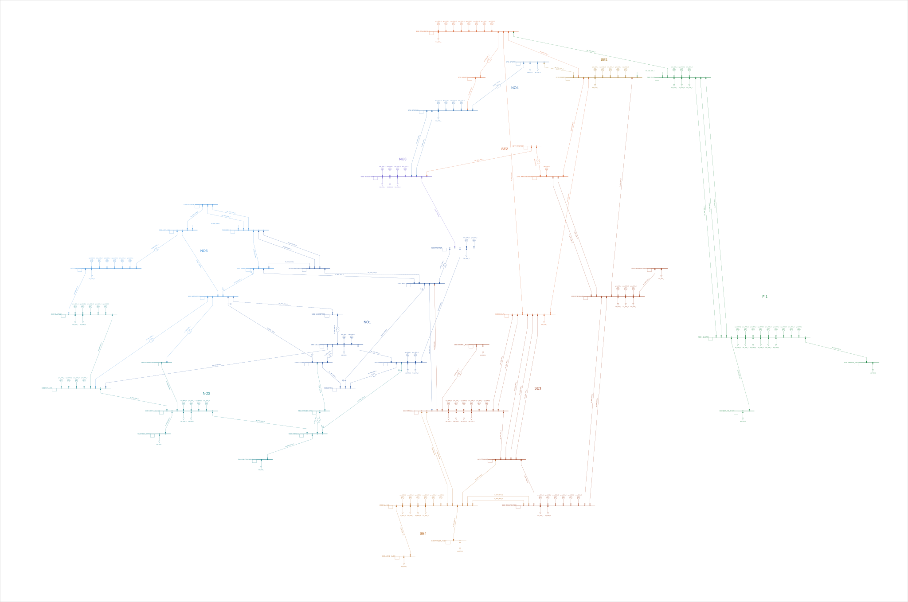

# PowerFactory

This folder holds the Nordic 44 cases as ready-made DIgSILENT PowerFactory projects, the
scripts that built them, and the PowerFactory results that the Python model is compared with.
PowerFactory reads the PSS/E RAW files through its own importer, so its network is built
without this project's parser, and its results close a triangle with pandapower and PSS/E.

| File | What it is |
|---|---|
| `Nordic44_2015.pfd` | 13 PowerFactory projects, the base case and twelve hours of 2015 |
| `export_projects.py` | Builds the projects and writes `Nordic44_2015.pfd` |
| `diagram.py` | Draws the single-line diagram, the same in every project |
| `run_ldf_batch.py` | Load flows for the 60 validation hours, two variants each |
| `run_n1_batch.py` | Contingency analysis (ComSimoutage) on five critical hours |
| `run_opf_batch.py` | DC optimal power flow (ComOpf) with nodal prices on three hours |
| `pf_n44.py` | Code shared by the scripts, which starts PowerFactory, imports RAW files, sets the study options and exports results |
| `exports/` | PowerFactory results as CSV, read by `scripts/10`, `13` and `17` |

Every project shows the same single-line diagram, here as exported from `N44_BC`. Open the
image to zoom in on the names.



## Opening the projects

The projects need PowerFactory 2024 SP2 or newer, and no Python.

1. Import `Nordic44_2015.pfd` with File > Import > Data. The thirteen projects appear in the
   folder you import into.
2. Activate a project, for example `N44_h0538`, the winter peak. It opens with its
   single-line diagram.
3. Run the load flow, the contingency analysis and the optimal power flow from the
   Calculation menu. Each command already holds the settings of the comparison.

### The projects

Each hour is PSS/E's solution of that hour (the dataset's `after_PF` RAW file), imported with
PowerFactory's PSS/E importer.

| Project | Snapshot | Why it is there | Compared in PowerFactory |
|---|---|---|---|
| `N44_BC` | base case | the model as published, which is not a solved power flow ([validation log, entry 1](../docs/validation_log.md#1-the-published-base-case-n44_bcraw-is-not-a-solved-power-flow)) | |
| `N44_h0027` | 2015-01-02, hour 3 | lowest SE2->SE3 transfer | load flow |
| `N44_h0175` | 2015-01-08, hour 7 | the loss of the Sima transformer has no AC solution | N-1 |
| `N44_h0538` | 2015-01-23, hour 10 | winter peak demand | load flow, N-1, DC-OPF |
| `N44_h0539` | 2015-01-23, hour 11 | highest production in Norway, SE1 and SE2 | load flow |
| `N44_h1109` | 2015-02-16, hour 5 | highest Finnish import | load flow |
| `N44_h1882` | 2015-03-20, hour 10 | highest SE3->SE4 transfer | load flow |
| `N44_h3657` | 2015-06-02, hour 9 | summer peak demand | load flow, DC-OPF |
| `N44_h4781` | 2015-07-19, hour 5 | summer lowest demand | load flow |
| `N44_h5370` | 2015-08-12, hour 18 | highest SE2->SE3 transfer | load flow, N-1, DC-OPF |
| `N44_h5600` | 2015-08-22, hour 8 | the loss of the Sima transformer has no AC solution | N-1 |
| `N44_h6949` | 2015-10-17, hour 13 | highest branch loading | load flow, N-1 |
| `N44_h8595` | 2015-12-25, hour 3 | winter lowest demand | load flow |

Each project differs from the plain import in five ways.

- The transformer ratios are exact. The importer rounds each transformer ratio to the nearest
  tap position, which moves the voltage at bus 5601 by up to 8.8·10⁻⁴ p.u.
  ([validation log, entry 6](../docs/validation_log.md#6-powerfactorys-psse-importer-rounds-transformer-ratios-to-the-tap-grid)),
  so the tap step of each transformer's type is changed until its tap position gives the RAW
  ratio exactly.
- The load flow has the options of the comparison, listed below.
- A contingency analysis has one outage per line and transformer, 71 in all. The eight radial
  connections of the HVDC terminals are left out, because losing one means losing the link.
- Every machine has the generation cost of `config/costs.yaml` (nuclear 10, hydro 20,
  thermal 35 EUR/MWh), and a DC optimal power flow minimises cost within RATE A and computes
  nodal prices.
- Every project has the same single-line diagram. The busbars sit at fixed positions
  that follow the map, with Norway to the west, Sweden in the middle and Finland to the east.
  Machines hang above their busbar and loads below it, every element shows its name, and no
  name, symbol or line covers another. While no calculation is shown, each bidding zone has
  its own colour and its name in the drawing. PowerFactory hides the names when the whole
  diagram is in view, so zoom in to read them. `diagram.py` holds the positions and draws it.

### What you should see in `N44_h0538`

These are the values of the PowerFactory runs in `exports/`. pandapower gives the same load
flow to the digits shown, since the two tools agree to 5·10⁻⁸ p.u. and 3·10⁻⁴ MW over the 60
validation hours.

| Study | Result | Value |
|---|---|---|
| Load flow | voltage at Hjälta (3100), the lowest in the network | 0.9396 p.u. |
| | flow on Hjälta-Ringhals circuit 2 (3100-3359), at Hjälta | 1,620.7 MW, loading 146.0 % |
| | output of the swing plant Oskarshamn (3300) | 5,334.6 MW |
| | losses in lines and transformers | 1,200.3 MW |
| Contingency analysis | outages without an AC solution | Sima-Aurland transformer (5300-5301), Kvilldal-Blåfalli (6000-6100) and Aurland-Hagafoss (5301-6001) |
| | worst overload | Hjälta-Grundfors (3100-3249) at 222.6 % after the loss of Hjälta-Porjus (3100-3115) |
| | lowest voltage | 0.850 p.u. at the Kristiansand HVDC terminal (5610) after the loss of Kristiansand-Arendal (5600-5603) |
| DC-OPF | total cost | 1,172,005 EUR/h |
| | nodal prices | 35 EUR/MWh in Finland and 20 EUR/MWh everywhere else |

Loading is PowerFactory's own, which differs from PSS/E's (see below).

## How the projects and the exports are made

All scripts run from the project's virtual environment with PowerFactory 2024 SP2 and its
Python API for Python 3.12. PowerFactory itself must be closed, because the scripts open its
local database, and only one script can run at a time.

```powershell
.venv\Scripts\python powerfactory\export_projects.py --check   # a few minutes
.venv\Scripts\python powerfactory\run_ldf_batch.py              # about 1 minute
.venv\Scripts\python scripts\10_validate_powerfactory.py
```

- `export_projects.py` builds the thirteen projects and writes the `.pfd` file. With
  `--check` it imports the file again into a temporary folder, runs every study that has
  results in `exports/` with the settings the projects carry, and compares. The load flows
  agree to 5·10⁻⁹ p.u., the contingency analyses converge in the same 355 cases with the same
  flows, and the DC-OPF gives the same prices and the same cost. The check also confirms that
  the thirteen diagrams are identical.
- The comparisons in `scripts/10`, `13` and `17` work from the committed exports, so
  PowerFactory is only needed to refresh them. `scripts/run_pipeline.py --powerfactory` runs
  the three batch scripts first.
- The paths to PowerFactory are in the `powerfactory` section of `config/base.yaml`, or in the
  variables `N44_PF_INSTALL_DIR` and `N44_PF_PYTHON_API`.
- **Start PowerFactory before importing scipy.** scipy's HiGHS libraries share DLL names with
  PowerFactory's, and once loaded they make the engine fail with ExitError 1001 ("cannot load
  DLL"). The scripts read the cost table with `yaml` for that reason.
- Everything happens in the folder `Nordic44` of the PowerFactory user. The batch scripts
  import each hour as a temporary project (`tmp_hNNNN`, so they never replace the projects of
  the `.pfd` file), solve it, export the results and delete the project together with its
  copy in the recycle bin. The local database does not shrink after deletions, and each
  import leaves about 0.4 MB in it, which is why the whole year is not run this way. The
  projects of `export_projects.py` stay in the folder.

### Hours and variants of the load flow

The load flows cover the ten representative hours (`config/representative_hours.yaml`) and 50
more drawn at random with seed 2015, leaving out the synthetic hour of the spring clock change.
The list is in `exports/hours.csv`.

Each hour is solved in two variants. Variant `imported` is the model exactly as PowerFactory's
importer builds it. Variant `exact` is the same model with the RAW file's transformer ratios,
as in the projects of the `.pfd` file.

### Load-flow options

The options match the pandapower runs and are set in `pf_n44.LDF_OPTIONS`.

| Option | Setting |
|---|---|
| Calculation | AC, balanced, positive sequence (`iopt_net = 0`), Newton-Raphson, flat start |
| Reactive limits | considered (`iopt_lim = 1`) |
| Transformer taps, shunts | fixed as in the RAW file (`iopt_at = 0`, `iPST_at = 0`, `iopt_asht = 0`) |
| Loads | constant power (`iopt_pq = 0`) |
| Active power | as dispatched, balanced by the reference machine, no active power limits |
| Interchange schedules | off (`iInterChg = 0`), since the snapshots are already solved for them |
| Convergence | 0.001 kVA on bus equations, 0.001 % on model equations (defaults 1 kVA, 0.1 %) |

### Contingency analysis

The analysis is AC, with every recording limit and filter opened, so the result file holds P,
Q, current and loading for every branch and the voltage of every bus, per contingency. The
batch runs the hours 5370, 6949, 538, 175 and 5600, chosen as the highest snitt-2 transfer, the
highest loading, the winter peak, and two hours in which the loss of the Sima transformer has
no solution. `scripts/13_validate_powerfactory_n1.py` compares them outage by outage with the
project's own AC N-1.

### DC optimal power flow

Every machine gets the linear cost of `config/costs.yaml` as a two-point operating-cost table
(`cpower`, `ccost`), and the LP uses the average slope. The settings are active-power control
`ictpg` (not `isCtrlP`, which belongs to unit commitment), the OPF limits
`iOPFCPmin`/`iOPFCPmax`, method DC (`iopt_ACDC = 1`), objective cost (`iopt_objDC = 1`) and
LMPs (`iCalcLMP = 1`). Prices are read as `m:LMP` and `m:SysLambda` on the terminals.

Two definitions differ from this project's ([validation log, entry 8](../docs/validation_log.md#8-powerfactory-prices-energy-at-its-reference-machine-in-the-dc-opf)).
PowerFactory's DC load flow ignores the active power of line-end shunts, and its system lambda
is the cost of the reference machine, even when that machine is at its limit.

## How the imported model looks

A few things matter when comparing element by element.

- Names carry the PSS/E keys. Terminals are `NUMBER NAME`, loads `lod_BUS_ID`, machines
  `sym_BUS_ID`, lines `lne_I_J_CKT` and transformers `trf_HV_LV_CKT`.
- Each PSS/E area becomes a grid, one per bidding zone.
- Line-end shunts (BI, BJ) become two `ElmLnecomp` objects inside the line. PowerFactory's
  terminal flows include them, as this project's do.
- Every plant with voltage control gets a station controller (`ElmStactrl`) that shares the
  reactive power among its machines, so Q is compared per plant.
- All six machines at the swing bus 3300 are reference machines, but PowerFactory gives the
  whole balance to one of them (`sym_3300_1`), so only the total of the bus is compared.
- For area interchange the importer creates one secondary controller (`ElmSecctrl`) per area,
  with PSS/E's PDES as setpoint. These controllers do nothing in an "as dispatched" load flow.
- RATE A/B/C become rating factors switched by a "Ratings" trigger, and the normal case is
  RATE A.
- Loading is defined differently. PowerFactory's `c:loading` uses a line's series current,
  without its end shunts, and a transformer's current. PSS/E uses the terminal current of
  lines and the MVA of transformers. On line 5101-5501, with a 974 Mvar reactor at one end,
  that is 27.5 % against 60.7 %. The comparison recomputes PSS/E's convention from
  PowerFactory's flows ([validation log, entry 7](../docs/validation_log.md#7-powerfactory-and-psse-measure-branch-loading-differently)).

## Exports

All tables have the column `h`, and the load-flow tables also `variant`. They keep
PowerFactory's own orientation and use PSS/E bus numbers.
`n44.validation.solution_from_powerfactory` orients them like PSS/E.

| File | Columns |
|---|---|
| `ldf_buses.csv` | bus, vm_pu, va_degree |
| `ldf_machines.csv` | bus, id, in_service, p_mw, q_mvar |
| `ldf_branches.csv` | kind, bus1, bus2 (HV, LV for transformers), ckt, in_service, p1_mw, q1_mvar, p2_mw, q2_mvar, loading_pct |
| `ldf_runs.csv` | converged, number of warnings |
| `transformer_ratios.csv` | RAW WINDV1 and the ratio PowerFactory imported, per transformer |
| `n1_cases.csv` | the outage and whether PowerFactory found an AC solution |
| `n1_branches.csv.gz` | per outage and branch, P and Q at both ends and PowerFactory's loading |
| `n1_buses.csv.gz` | per outage and bus, the voltage |
| `opf_buses.csv` | LMP and system lambda per terminal |
| `opf_machines.csv` | dispatch per machine |
| `opf_runs.csv` | solver status and warnings |

## Licence

The projects in `Nordic44_2015.pfd` and the exports are built from the Nordic44 dataset
(L. Vanfretti et al., *Nordic44 – 2015 Powerflow Data*, Zenodo,
[doi:10.5281/zenodo.162907](https://doi.org/10.5281/zenodo.162907)) and are shared under its
licence, CC BY-NC 4.0. The MIT licence of the code does not apply to them.
